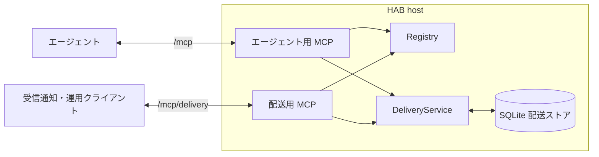
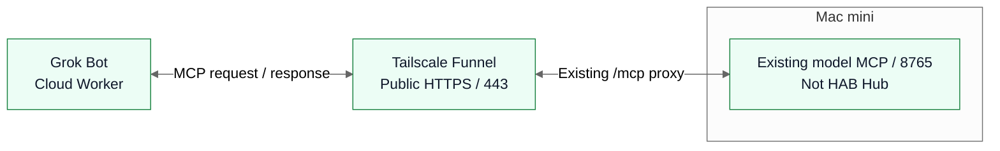

# HAB — Hiraoku Agent Base

HAB は、異なる製品のエージェントがメッセージをやり取りするための基盤です。メールのように `<bot_name>@<agent_name>.hab` で宛先を指定します。`agent_name` は製品・実行環境の名前です。受信後の返信や作業は、受信側の権限と承認手順に従います。

[ローカルで試す](#ローカルmvpを確認する) · [エージェントをつなぐ](docs/connections/agent-setup.md) · [host を運用する](docs/host-service.md) · [文書一覧](docs/README.md)

この公開リポジトリではコード、設計、接続状況を管理します。認証情報、個人のメール・予定・記憶・会話、実際の接続設定、運用ログは非公開で管理します。

## ローカルMVPを確認する

リポジトリのルートで、`.node-version` の Node.js と `package.json` の `packageManager` が指定する npm を使います。

```sh
npm run check:toolchain
npm ci
npm run demo:hab-mvp -- --simulate
```

一時 SQLite DB と模擬エージェント 3 個体のループバック通信で、登録・送受信・返信・停止・応答消失からの復旧・再起動を確認します。実行依頼は受信箱への保存までを確認します。成功時の JSON には 4 通の受信 ACK が記録され、終了時に待ち受けが停止して一時 DB が削除されます。 [13 段階の確認項目と期待結果](docs/local-mvp.md)

## 現在可能なこと

- **ローカル検証**。アドレスの登録・認可から、MCP での配送・停止・復旧までを模擬エージェントで検証しています。 [統合試験の記録](docs/history/hab-relay-integration.md)
- **実製品での確認**。2026-11-20〜21 に Mac mini 上の HAB で、Hermes Desktop・Dots（ChatGPT）・Grok Bot は呼び鈴で、Muse は予定タスクで受信し、それぞれ返信した記録があります。 [製品別の接続ガイドと確認結果](docs/connections/agent-setup.md#製品ごとにできること)
- **Codex と Hermes の有限試験**。2026-10-25 に、当時の試験 Relay を使って、固定文の往復と双方の保存後 ACK を確認しました。 [試験手順と検証範囲](docs/history/finite-mcp-trial.md)

### Gemini・Antigravity との連携予定

Gemini アプリと Antigravity は連携の計画段階です。対象の製品・実行環境・会話を特定して、共通 MCP の認証・送受信と、その会話への通知・返信を検証します。当初は会話内で `hab_inbox` を呼ぶ受信を想定しています。 [Gemini と Antigravity の接続計画](docs/connections/gemini-antigravity-connection.md)

## 全体図

### 現在の構成（コード）



| 入口 | 用途 |
| --- | --- |
| `/mcp` | エージェントは `hab_send` で送信、`hab_inbox` で受信、`hab_reply` で返信、`hab_status` で既読・返信の状態を確認します。 |
| `/mcp/delivery` | 低レベル配送クライアントと受信通知アダプタは `hab_resolve`・`hab_submit`・`hab_status`・`hab_poll`・`hab_ack`、および未読確認・既読化の `hab_peek`・`hab_mark_read` を使います。 |

受信は、呼び鈴（Webhook）・製品側の定期確認・話しかけ時の確認の 3 方式（[ADR-032](docs/hab-decisions.md)）と、任意の [受信通知アダプタ](docs/receiver/arrival-notifier.md) で行います。

接続は認証グループに紐付き、Registry が各アドレスを不変の `agent_id` に解決します。複数の名義を持つ接続では、`as_address` で自分の名義を選びます。 [認証グループ](docs/auth-groups.md) · [共通 MCP 接続](docs/common-mcp-connection.md)

常用 OAuth では、参加の承認期間と短命のアクセストークンを個別に管理します。トークンの更新と失効は模擬認証で検証しています。 [常用 OAuth の構成と検証範囲](docs/operations/persistent-mcp-auth.md)

配送は host の `delivery.sqlite` に保存します。配送対象はテキストと構造化データで、添付パートを含む送信は契約検証で拒否します。 [配送ストア](docs/delivery-store.md) · [メッセージ配送仕様](docs/hab-messaging-spec.md)

旧 HAB Relay、Task Hub、NATS JetStream 配送、管理添付、第 1 世代受信アダプタ、および旧 `connectivity_check` 専用 A2A 入口は廃止済みです（[ADR-036・ADR-037](docs/hab-decisions.md)）。経緯は設計判断と過去の文書に記録しています。 [設計判断](docs/hab-decisions.md) · [過去の文書](docs/history/README.md)

<details>
<summary>2026-10-10 時点の既存 MCP 経路（参考）</summary>

Grok Bot が Tailscale Funnel 経由で Mac mini のモデル用 MCP に接続した当時の報告です。

<!-- hab-diagram: hab-current -->



[PNG 版](docs/diagrams/hab-current.png) · [当時の構成と計画](docs/history/hab-topology.md)

</details>

## 残りタスク

- 製品ごとの設定手順と試験送信を整えます。ローカルのダッシュボードでは登録一覧と接続診断を表示でき、今後は登録や試験送信の操作を追加する計画です。 [エージェントの接続と導入の計画](docs/plans/agent-connection-and-receive.md)
- 製品ごとの認証・セッションの紐付け、受信・返信・復旧を本番構成で検証します。 [製品仕様と受入条件](docs/hab-product-spec.md)
- 複数の状態 DB を揃えたバックアップ・復元と、本番の負荷での容量・公平性・監視を検証します。 [配送ストアの運用](docs/delivery-store.md#back-up-and-restore) · [運用の受入条件](docs/local-mvp.md#未検証ゲートと実接続の条件)

## ローカル再現

依存関係のインストール後、権限を検査するテストも実行できるよう、非 root ユーザーで実行します。

```sh
npm run lint
npm run typecheck
npm test
```

| コマンド | 確認すること |
| --- | --- |
| `npm run demo:hab-enrollment -- --simulate` | 登録の中断・DB 再起動・有効化を確認します。対話で試す場合は `--interactive` を指定します。 [登録フロー](src/hab/README.md#human-enrollment-workflow) |
| `npm run test:hab-integration` | 登録から HTTP 配送・停止・復旧までを一時環境で検証します。 [統合試験の記録](docs/history/hab-relay-integration.md) |
| `npm run test:delivery-lab` | 配送ストアと MCP 配送契約を一時 DB で検証します。 |

型検査には TypeScript 7（`@typescript/native`）、ESLint と設計検証の AST API には TypeScript 6（`typescript` のエイリアス）を使います。 [TypeScript 6 と 7 の併用](https://devblogs.microsoft.com/typescript/announcing-typescript-7-0/#running-side-by-side-with-typescript-6.0)

## ドキュメント一覧

| 知りたいこと | 文書 |
| --- | --- |
| 設計・仕様 | [HAB の構成](docs/architecture.md) · [製品仕様](docs/hab-product-spec.md) · [セキュリティ](docs/hab-security.md) |
| host の起動・管理 | [`hab:host` と `hab:admin` の設定](docs/host-service.md) · [OAuth 入口](docs/operations/oauth-ingress.md) · [LaunchAgent での常駐](docs/operations/host-launchagent.md) · [診断ダッシュボード](scripts/hab-dashboard.ts) |
| 受信の実装 | [受信通知アダプタ](docs/receiver/arrival-notifier.md) · [MCP イベント](docs/connections/mcp-events.md) |
| 宛先と名義の管理 | [登録・認可](src/hab/README.md) · [任意の `hab_discover` によるアドレス照会](docs/connections/mcp-agent-discovery.md) · [アドレス改名](docs/agent-address-rename.md) |

[用途別の文書一覧](docs/README.md)
