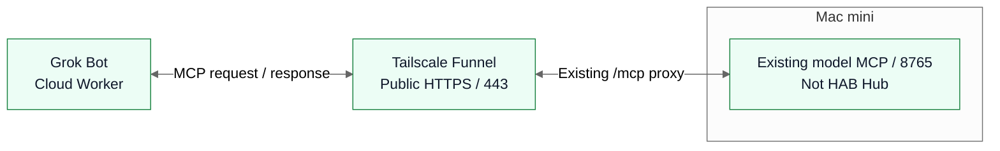

# HAB — Hiraoku Agent Base

HABは、個人文脈を持つDots（スタローン）、クラウドで働くGrok Bot、Macで実験・開発するHermesを、共通のAgent Hubでつなぐための基盤です。依頼・担当・進捗・結果を仲介し、それぞれのエージェントが持つ判断や既存の仕事を尊重します。Claude Code・Codex・Cursorなども、MCPクライアントとしての接続対象に含めます。配送の許可と、開発・業務を実行する権限は別に管理します。

この公開repoは、Hubのコードに加え、HAB全体の設計・判断・接続状況を管理します。個人のメール・予定・記憶・会話、秘密値、実際の接続設定や運用ログは管理しません。repoは同じ履歴を保持したまま[hiraoku-agent-base](https://github.com/s-hiraoku/hiraoku-agent-base)へ改名しました。

通信部分の**HAB Relay**は、HAB固有の登録・アドレス、Task Engine、製品別Adapterから独立した再利用可能なコンポーネントとして実装しています。[正式仕様](docs/hab-relay-spec.md)でstore-and-forward、個体認証、受信ACK、Task Engineとの境界、受入れ条件を管理し、[実装手順と検証範囲](src/relay/README.md)に現在の到達点を記録します。

**現在はテキスト・構造化データの配送基盤、MCP送受信・アドレス解決、人向けの登録フローを模擬認証と一時DB／loopback通信で検証済みです。本番のDots ↔ Hub ↔ Grok／Hermes接続は未完了です。** 実個体の認証binding、本番管理入口、添付bytes、runtimeへの配線・運用整備などが残っています。

2026-10-25に、**認証は参加グループ単位、Botの切り分けはアドレス単位**とする[認証設計](docs/relay-auth-groups.md)を採用しました。1認証主体に複数アドレスを紐付けられる共通契約とし、グループ外の名義使用・受信箱操作を拒否します。現行の1対1 bindingからの移行とtoken自動更新は未実装です。

## ローカルMVPを確認する

Node 24以上で、次の有限コマンドから[15段階の動作確認](docs/local-mvp.md)を再現できます。新規一時DBと模擬3個体のloopback通信だけを使い、終了時に停止・削除します。

```sh
npm ci
npm run demo:hab-mvp -- --simulate
```

登録・送受信・返信・停止・応答消失・全DB再起動・固定Taskの結果配送まで確認し、配送6通のACK・Task1件・残存実行0件をJSONで返します。実個体の接続、全hostの整合backup／restore、G1全体・本番の受入れは別ゲートです。

## 全体図

2026-10-10時点の**確認済み経路（本人報告）**です。既存model MCPはHAB Hubとは別サービスです。モデル一覧取得・認証なし拒否の報告は、Hub接続やmodel実行・費用枠の確認を意味しません。

<!-- hab-diagram: hab-current -->



[PNG fallback](docs/diagrams/hab-current.png) · [HABの目標構成・通信方向・認証責任](docs/hab-topology.md)

Hub・Hermesの限定接続は準備段階、Dots/ChatGPT MCPは未検証です。目標構成は詳細文書で確認済み経路から分けて示します。

## 現在可能なこと

「実装済み」はコードとローカルfixtureの確認、「実接続確認済み」は対象の実サービスでの確認を指します。本人報告は独立した実測とは区別します。

| 項目                                                                                       | 状態・根拠                                                                                                                       |
| ------------------------------------------------------------------------------------------ | -------------------------------------------------------------------------------------------------------------------------------- |
| 永続タスクキュー、HTTP MCP、lease/fencing、監査・outbox、停止・照合                        | **実装済み**。SQLiteとローカルD1で失敗系を検証                                                                                   |
| 固定テキストの`connectivity_check`、固定候補metadataの`shift_log_inventory`、診断ping/pong | **実装済み**。信頼済みpolicyで個別に許可する限定契約。自由入力・任意shellなし                                                    |
| JWT/Auth0 resource-server、OAuth discovery、Events、限定キー管理、Hermes隔離bridge         | **実装済み**。通常runtimeと専用inventory入口の認証配線をfixtureで検証。本番の主体・設定・実接続は未確認                          |
| Relayの独立契約・SQLite受付／配送、重複防止、lease、ACK、状態照会 | **実装済み／模擬検証済み**。本文はテキスト・構造化データ。既定経路は添付を拒否。任意のhost組立てで添付の受付・配送・ACKと削除を追加でき、配送受領だけでTaskを実行しない |
| Relayの送信outbox・受信inbox、本文引渡し、期限切れ・記録回収 | **実装済み／模擬検証済み**。再起動・応答消失・古いlease・削除途中失敗を試験。実製品内の永続保存は未確認 |
| Relay専用MCP 4ツール・HTTP adapter | **実装済み／既存runtimeへ未配線**。`relay_submit/status/poll/ack`を一時loopback HTTPでも検証。Bearer検証port・認可・監査がなければ拒否し、入力／応答・期限・同時数を制限 |
| Relay専用MCPクライアント | **実装済み／模擬検証済み**。永続outbox／inboxを固定HTTP接続先につなぎ、応答消失後の再起動・同じ要求での復旧を検証。通信層は自動再送せず、実個体の認証binding・導入は未確認 |
| HAB登録・固定アドレス・binding／認可の核 | **実装済み／模擬検証済み**。原子的予約、変更／再利用禁止、権限分離、有効化・失効・blockを実装。HAB専用catalogの`relay_resolve`でアドレスを解決し、模擬3個体がHTTPで往復。既存runtimeへは未配線 |
| 人向け登録フロー | **実装済み／模擬検証済み**。承認済み製品の選択→アドレス提案・確定→検証済み個体接続のbinding→操作権限を選んで有効化。専用checkpointで中断／再起動に対応。本番管理認証・接続選択の配線は未実施 |
| 登録から配送・停止・復旧までの統合 | **模擬17シナリオ検証済み**。登録済み3個体のnative HTTP往復、不在、応答消失、DB／listener再生成、失効・block・本文引渡しを一連で検証。[再現手順と限界](docs/hab-relay-integration.md)を参照。G1全体・実製品の受入れは未完了 |
| 管理添付の保存・配送・削除 | **任意構成で実装済み／模擬検証済み**。source永続化・SHA検証・有限送信worker・認可付きMCP転送・durable受信・ACK・物理削除を実装。応答消失・再起動後も同じID／bytesで照合。[転送](docs/attachment-transport.md)と[送信journal／worker](docs/upload-journal.md)、[message outbox連携](docs/attachment-outbox.md)を参照。既定経路は添付を拒否。[受信checkpoint／worker](docs/attachment-receiver.md)まで実装。本番配線・運用整備が残る |
| Hermesの今回のinventory接続                                                                | **準備済み／実接続未確認**。専用profile・code・dependency bundleと本人Terminalの測定報告あり。実キー/API/model起動・往復は未実施 |
| 既存の別MCPとTailscale/Grok                                                                | **本人報告による実接続確認済み**。認証なし拒否も報告済み。HAB Hubへの接続やHubのOAuth成功を証明しない                            |
| Dots ↔ Hub ↔ Grok本番、開発実行手段のHub接続                                               | **計画**。Cursor利用可能性は本人見込み。Claude Channelはmock、Cua起動は未完                                                      |

質問返信intentの統合までのローカル検証では、Node **1310件**・Python **47件**（34件＋13件）、lint・typecheck・buildが成功しました。CIではRuffも確認します。これは本番接続の受入れではありません。Relayの実装範囲は[実装手順](src/relay/README.md)、HABの[登録・認可境界](src/hab/README.md)、既存の固定Task接続ゲートは[MVP受入れ表](docs/mvp-acceptance.md)を参照してください。

## Relayの残りタスク

以下は2026-10-19時点の残り**8大項目**です。登録・認可の核、MCPアドレス解決を含む模擬3個体のHTTP往復、人向け登録フローまで実装しました。1の本番管理認証・実個体bindingなどが残るため、まだ項目を完了扱いにはしていません。項目ごとの規模は異なり、件数から完成率・納期を算出するものではありません。実装変更は通常PRに分け、依存する変更は`gh stack`で管理します。

| 順序 | タスク | 完了の目安 |
| --- | --- | --- |
| 1・進行中 | 登録・アドレス解決・認証binding | 核・MCP lookup・人向け管理フローは実装済み。本番管理認証・接続選択の配線と実個体のbinding実証が残る |
| 2・進行中 | 管理添付 | source保存・有限送信workerからMCP転送・durable受信・ACK・削除まで模擬確認済み。送受信キュー連携も実装済み。有限保守cycleも実装済み。snapshot／停止復元の核も実装済み。実運用の実行契機・監視、復元後の照合、公平性・本番配線が残る |
| 3・進行中 | 個体別の容量・公平性 | message／blobの個体別上限・最低予約枠、送信者巡回・永続scan位置、任意の1プロセス内rate・公平writer受付を模擬検証済み。本番policy・監視・実負荷と複数writer全体の評価が残る |
| 4・進行中 | Task bridge | 明示引受け・永続link・固定Taskの同key受付／照合と、accepted／resultの永続返信・送信outbox連携を模擬検証済み。受信側の永続返信budgetも任意構成で模擬検証済み。有限hostの明示操作・停止／照合、質問返信の永続intent・起動時一覧も模擬検証済み。実製品の全入口への適用と本番配線が残る |
| 5・進行中 | 運用・復旧 | クリーンsetup、既存runtimeへの明示配線、listener／proxy／header上限、明示migration、保守cycleと配送DBのsnapshot／停止復元は実装済み。実runtimeの静止・復元後の昇格、停止・照合・復旧手順 |
| 6・進行中 | 統合試験 | 人向け登録→HTTP配送→不在・失効・競合・停止・復旧の17シナリオは確認済み。添付、実Adapterのloop制御、運用restore等は機能追加とともに拡張 |
| 7・先行調査 | 実製品の接続能力確認 | Grok Bot・Dots・Hermes等の各個体について、識別、永続outbox／inbox、再送契機、poll／wake対応を確認 |
| 8・承認後 | 本番接続・E2E | 接続先、主体・scope、送信データ・費用・停止条件を確定し、承認後に段階接続 |

**ローカルMVPは[一つの有限コマンド](docs/local-mvp.md)で再現可能です。** 15段階で登録・実HTTP MCP・送受信・返信intentとACKの再開・running Taskのgate維持・停止を確認しました。次は実個体のG0能力・接続条件の確定と、全hostの整合backup／restore・本番運用の受入れです。[単一owner管理](docs/adapter-owner.md)を任意構成として追加し、13件で二重起動、通信中の解放拒否、native process終了後の再取得を検証しました。[質問返信の永続intent](docs/answer-intents.md)を独立部品として追加し、44シナリオでoutbox前の保存、再起動後の一覧・同ID引渡し、応答消失、本文解放、期限・30日GC、権限・並列producerを検証しました。[有限Adapter host](docs/adapter-host.md)で受信・明示回答／Task引受け・返信・送信を組み立て、30シナリオで永続停止・世代・遅い応答・timeout後のslot保持・同ID照合・native HTTP MCPを検証しました。[受信側の永続返信budgetとloop制御](docs/adapter-reply-budget.md)を独立部品として実装し、36シナリオで原要求・thread・個体rate、再起動・不明な送信・通知ループ拒否・Task返信との共通枠を検証しました。[明示引受けとTask link](docs/task-bridge.md)を実装し、30シナリオでACKとの分離・固定Task・応答消失・再起動・fencingを検証しました。受付／結果の返信outboxも実装し、32シナリオで固定ID・期限・不明な引渡しの再照合・権限失効・模擬配送／ACKを検証しました。[公平writer受付とHTTP配線](docs/writer-admission.md)を任意構成として実装し、core20シナリオ・MCP26シナリオで個体別rate・巡回・失効・timeout後のslot保持を検証しました。[添付blobの個体別容量・最低予約枠](docs/attachment-capacity.md)を実装し、24シナリオで宣言bytes・保持記録・binding・native競合・認証分離を検証しました。[公平pollと永続scan位置](docs/relay-fair-poll.md)を実装し、25シナリオで巡回・再起動・権限・lease・SQL rollbackを検証しました。[message個体別容量・最低予約枠](docs/relay-agent-capacity.md)を実装し、15シナリオで保持record・bytes・同時受付を検証しました。[配送DBのsnapshot／停止復元](docs/sqlite-snapshot-bundle.md)を実装し、26シナリオで一括lock・WAL・改ざん拒否・3 profileの復元・schema4/5互換を確認しました。[サーバー添付の有限保守cycle](docs/attachment-maintenance.md)を実装し、16シナリオで専用認可・孤立upload回収・部分失敗を確認しました。[受信checkpoint／worker](docs/attachment-receiver.md)を実装し、29シナリオで途中再開・lease更新・ACK復旧を確認しました。添付messageの[送信outbox連携](docs/attachment-outbox.md)は実装し、21シナリオを追加検証しました。[登録・復旧17シナリオ](docs/hab-relay-integration.md)、[添付MCP転送37件](docs/attachment-transport.md)、[送信journal／worker48件](docs/upload-journal.md)を模擬検証済みです。孤立回収の運用、整合backup、公平性、実製品での本番往復も残っています。新規credential発行・公開・実エージェント接続・自動常駐はこのREADMEを根拠に開始しません。

## ドキュメント一覧

| 文書                                          | 内容                                                           |
| --------------------------------------------- | -------------------------------------------------------------- |
| このREADME                                    | HABの目的、全体図、現在可能なこと、入口                        |
| [設計思想](docs/hab-principles.md)            | 個人文脈・Cloud Worker・Local Agentの分業、疎結合、費用制約    |
| [役割と機能](docs/hab-roles.md)               | Dots／Grok／Hermes／Claude Code／Codex／Cursorの担当と接続状況 |
| [処理の流れ](docs/hab-workflow.md)            | 依頼 → 振分け → 承認 → 実行 → 結果、失敗・停止・照合           |
| [セキュリティ](docs/hab-security.md)          | Auth0、Tailscale、権限、秘密、停止と公開境界                   |
| [設計判断記録（ADR）](docs/hab-decisions.md)  | 採用理由、不採用・保留・未決定案                               |
| [競合比較とロードマップ](docs/hab-roadmap.md) | 一次資料に基づく参考実装と段階的な接続計画                     |

## ローカル再現

Node 24以上で実行します。fixtureは実エージェントや本番callbackへ接続しません。

試験は非rootユーザーで実行してください。rootは書込み拒否をすり抜けるため、コード改ざん検査やpilot／inventory inspectorの権限系試験は検証できず、root実行時は理由付きでskipされます（Dockerなどのroot CIでは非rootユーザーに切り替えます）。

```sh
npm ci
npm run lint
npm run typecheck
npm test
python3 -B -m unittest discover -s hermes_bridge -p 'test_*.py'
python3 -B -m unittest scripts.test_inventory_token_input
```

`node src/server.ts` はloopback HTTP MCPを起動しますが、既定の認証は全件拒否です。Auth0・peer registry・必要なserviceを明示的に配線するまで本番Hubとして公開しません。`npm run build` はWorker版を生成します。D1/Workerは移植性の検証対象で、現在の本番方針はMac＋SQLiteです。

上記のserverは既存Task用で、Relay専用HTTP adapterは別moduleとして存在し、このserverへは未配線です。Relayだけの模擬試験は`node --test test/relay-*.test.js`で再現できます。fixtureは新規の一時DB・ダミーデータだけを使い、本番DB・既存Hermes設定・認証・cron・公開経路を変更しません。

人向け登録フローは`npm run demo:hab-enrollment -- --simulate`で、中断→DB再起動→有効化を再現できます。対話操作は`--interactive`を指定します。どちらも新規の一時DB・模擬主体のみを使い、終了時に削除します。実Botを登録するコマンドではありません。実hostへの組込み条件と再開時の扱いは[登録フロー](src/hab/README.md#human-enrollment-workflow)を参照してください。

登録からHTTP配送・停止・復旧までの一連の模擬検証は`npm run test:hab-integration`で再現できます。[試験matrix](docs/hab-relay-integration.md)には、17件の結果と障害注入の方法、本番接続に進む前の未確認範囲を記録しています。

通常runtimeはinventoryを拒否します。固定1件の専用入口と、認証→子プロセス→結果→停止のモデルなし統合テストは[専用inventory往復](docs/inventory-end-to-end.md)を参照してください。実キー発行・Hermes/model起動の承認や本番往復を済ませたという意味ではありません。

## 技術文書

[Hub内部設計](docs/architecture.md)、[認証・Events・worker](docs/local-integration.md)、[Auth0境界](docs/auth0-boundary.md)、[ping/pong](docs/ping-pong-mvp.md)、[inventory MVP](docs/mvp-inventory.md)、[Hermes接続](docs/hermes-connection.md)、[固定pilot履歴](docs/fixed-pilot.md)、[import隔離](docs/hermes-import-boundary.md)、[一時キー](docs/local-hermes-key.md)、[永続停止](docs/durable-stop-gate.md)、[移植とEvents](docs/migration-plan.md)、[Auth0アカウント手順](docs/auth0-account-step.md)を参照してください。実運用の手順・値は承認後に非公開で管理します。

固定1件の次段階は、[positive getとworker主体確認](docs/fixed-readback-worker-identity.md)を参照してください。fixtureの成功結果はHermesの実行成功とは区別します。

共通Relayの起動関数と接続の承認条件は[ローカルRelayホスト](docs/local-relay-host.md)を参照してください。loopback・全拒否設定での常駐起動と401/403拒否を確認済みです。実個体の認証・binding、Hermes/Dotsとの往復は未検証です。停止・再起動は[ユーザーLaunchAgent手順](docs/local-relay-launchagent.md)にまとめています。

承認後の非公開設定を明示して起動する共通CLIは[ローカルRelayサービス](docs/local-relay-service.md)を参照してください。コードの検証と実エージェント接続の結果は区別します。各エージェント自身のMCPクライアントによる[共通接続手順](docs/common-mcp-connection.md)では、個体認証、受信の起動、保存後のACK、実エージェント往復の完了条件を分けています。外部実行APIは必須ではありません。

OAuthを使う共通MCP公開入口は[接続手順](docs/relay-oauth-ingress.md)を参照してください。任意の第2loopback入口とローカルMCPは同じRegistry・キューを使い、既定は全拒否です。公開経路・OAuth登録・実Dots往復は別途検証します。
