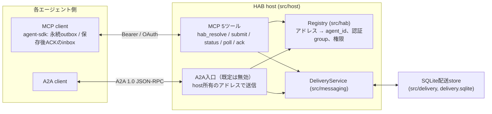
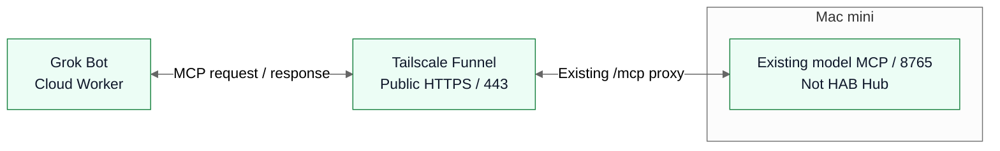

# HAB — Hiraoku Agent Base

HABは、Dots（スタローン）、Grok Bot、Hermes、Claude Code・Codex・Cursorなどのエージェント同士がメッセージをやり取りするための基盤です。メールのように各エージェントへ`<bot_name>@<agent_name>.hab`形式のアドレスを結びつけ、そのアドレスで送受信するセッションを特定します（`agent_name`は製品・実行環境の名前です）。新しいエージェントも、標準のMCPクライアントかA2Aクライアントから接続できることを目指します。受信側のhostがモデルを使わず定期poll・永続保存・ACKを行い、受信エージェントが内容を判断して既存の権限・承認機構で処理します。配送の許可と、開発・業務を実行する権限は別に管理します。

標準接続は[共通MCP接続](docs/common-mcp-connection.md)と[受信supervisor](docs/receiver/receive-supervisor.md)を基準にします。通常の質問・回答にTaskは不要です。A2A入口は明示的に有効化する入口（既定は無効）です。旧Task Hub（固定Task・汎用テキストTask）は2026-11-12に削除しました。Hermes固有のモデル実行・承認adapterを標準接続の必須段階にはしません。[設計判断 ADR-015](docs/hab-decisions.md)に責務と適用範囲を、ADR-016に現在の構成（単一host、エージェントSDK）を、ADR-018に配送storeをSQLite単独にした判断を記録します。

GUI・MCPで簡単にエージェント間通信を始めるための[HAB製品仕様](docs/hab-product-spec.md)では、登録・宛先選択・状態表示・privateなPC/モバイル利用を定義します。hostのSQLite配送storeと、エージェント間相互運用の入口としてのA2Aは採用済みです。確定要件と実装・本番配備の状況は区別しています。

この公開repoは、Hubのコードに加え、HAB全体の設計・判断・接続状況を管理します。個人のメール・予定・記憶・会話、秘密値、実際の接続設定や運用ログは管理しません。repoは同じ履歴を保持したまま[hiraoku-agent-base](https://github.com/s-hiraoku/hiraoku-agent-base)へ改名しました。

以前の通信部分**HAB Relay**（独自のSQLite配送storeを持つ独立コンポーネント）は2026-11-07に廃止し、**エージェント間の相互運用はA2Aへ置き換えました**（[ADR-016](docs/hab-decisions.md)）。配送は一度NATS JetStreamへ移しましたが、2026-11-13にhost内の1つのSQLiteファイルだけで行う形へ戻しました（ADR-018、[配送store](docs/delivery-store.md)）。残したのはmessage契約（`src/messaging`）とエージェント向けMCPの5ツールです。MCP tool名`hab_*`は既存の接続設定との互換のため名前だけ残しています。起動・管理コマンドは`npm run hab:host`／`hab:admin`で、旧名の`hab:host`／`hab:admin`も同じコマンドの別名として使えます。各部分の置き場所は次のとおりです。

| 部分 | 場所 |
| --- | --- |
| message契約・`DeliveryService` interface | [`src/messaging`](src/messaging/index.ts) |
| アドレス・認証group・権限・容量（Registry） | [`src/hab`](src/hab/README.md) |
| 唯一のhost（設定・HTTP・監査・管理CLI・MCP server・A2A入口） | [`src/host`](src/host)（MCP serverは`src/host/mcp`） |
| 配送store（SQLite、`delivery.sqlite`） | [`src/delivery`](docs/delivery-store.md) |
| エージェント側の永続outbox／保存後ACKのinbox・MCP client | [`src/agent-sdk`](src/agent-sdk/README.md) |

store-and-forward、個体認証、受信ACK、期限などの要件は[メッセージ配送の正式仕様](docs/hab-messaging-spec.md)（旧HAB Relay仕様）で引き続き管理します。

**現在はテキスト・構造化データの配送基盤、MCP送受信・アドレス解決、人向けの登録フローを模擬認証と一時DB／loopback通信で検証済みです。本番のDots ↔ Hub ↔ Grok／Hermes接続は未完了です。** 本番の認証binding・管理入口、runtimeへの配線・運用整備などが残っています。

2026-10-25、**実Codexと実Hermes（双方`gpt-6.1-sol`）の共通MCPによる固定文・返信・双方の保存後ACK**をMac内で確認しました。試験認証の失効・秘密と追加設定の除去・試験Relay停止も確認済みです。[有限試験の手順と限界](docs/history/finite-mcp-trial.md)に、hostの時刻・ID生成と保存の補助、使用CLI、操作承認、回帰検証を記録しています。実Dots接続と常駐・自律運用は別の未完了項目です。

2026-10-25に、**認証は参加グループ単位、Botの切り分けはアドレス単位**とする[認証設計](docs/auth-groups.md)を採用しました。1認証主体に複数アドレスを紐付けられる共通契約とし、グループ外の名義使用・受信箱操作を拒否します。Registryのグループ・所属・認可・停止・監査を合成主体で検証済みです。共通MCPの基本5操作で`as_address`による名義選択と、通常サービスの明示opt-inに対応しています。

[常用OAuthモード](docs/operations/persistent-mcp-auth.md)は、明示した参加承認期間と短命access tokenを分離します。更新された短命tokenを同じ接続へ対応させ、参加終了/取消後の認証を拒否します。接続設定は往復確認後も維持します。模擬issuerとloopbackで更新・失効・保存後ACK・再起動保持を検証しており、実Auth0/hostのrefresh、実Dots接続と常駐受信の受入れは未完了です。

## ローカルMVPを確認する

Node 26以上で、次の有限コマンドから[13段階の動作確認](docs/local-mvp.md)を再現できます。新規一時DBと模擬3個体のloopback通信だけを使い、終了時に停止・削除します。

```sh
npm ci
npm run demo:hab-mvp -- --simulate
```

登録・送受信・返信・停止・応答消失・全DB再起動・execution_requestが保存だけされ実行されないことまで確認し、配送4通のACKをJSONで返します。実個体の接続、全hostの整合backup／restore、G1全体・本番の受入れは別ゲートです。

## 全体図

### 現在の構成（コード）

Relay廃止後（[ADR-016](docs/hab-decisions.md)）の構成です。実線はmainのコードとローカル試験で確認した経路で、本番配備や実製品の常時接続を意味しません。A2A入口は設定の`a2a` sectionがあるときだけ開きます。



宛先は`<bot_name>@<agent_name>.hab`形式のアドレスで指定し、hostのRegistryが不変の`agent_id`へ解決します。送信者の名義と受信箱は、引数のエージェント名ではなく認証済みの接続から決まります。

### 2026-10-10時点の既存MCP経路（参考）

2026-10-10時点の**確認済み経路（本人報告）**です。既存model MCPはHAB Hubとは別サービスです。モデル一覧取得・認証なし拒否の報告は、Hub接続やmodel実行・費用枠の確認を意味しません。

<!-- hab-diagram: hab-current -->



[PNG fallback](docs/diagrams/hab-current.png) · [HABの目標構成・通信方向・認証責任](docs/history/hab-topology.md)

上図は2026-10-10時点の別MCP経路です。その後のCodex／Hermesの共通MCPによる有限往復（当時の試験Relay）は[試験記録](docs/history/finite-mcp-trial.md)を参照してください。DotsのHAB MCP接続は未検証です。[topology](docs/history/hab-topology.md)の目標図は、Relay導入前のTask Hub計画を記録したものです。

## 現在可能なこと

「実装済み」はコードとローカルfixtureの確認、「実接続確認済み」は対象の実サービスでの確認を指します。本人報告は独立した実測とは区別します。

| 項目                                                                                       | 状態・根拠                                                                                                                       |
| ------------------------------------------------------------------------------------------ | -------------------------------------------------------------------------------------------------------------------------------- |
| message契約（`src/messaging`）・SQLite配送storeの受付／配送、重複防止、lease、ACK、状態照会 | **実装済み／模擬検証済み**。配送はhostのSQLite配送storeのみ（ADR-018。JetStream版の旧messageは移行しない）。本文はテキスト・構造化データ。添付partは廃止し契約検証で拒否。配送受領だけでTaskを実行しない |
| エージェントSDKの送信outbox・受信inbox、本文引渡し、期限切れ・記録回収 | **実装済み／模擬検証済み**。再起動・応答消失・古いlease・削除途中失敗を試験。実製品内の永続保存は未確認 |
| hostのMCP 5ツール・HTTP入口 | **実装済み／ローカル実往復あり**。`npm run hab:host`で起動するhost（`src/host`、MCP serverは`src/host/mcp`）が`hab_resolve/submit/status/poll/ack`を公開し、任意で`hab_discover`を追加できる。任意のOAuth入口も同じ5ツールを提供。Bearer検証・認可・監査がなければ拒否し、入力／応答・期限・同時数を制限 |
| A2A入口 | **実装済み／模擬検証済み・既定は無効**。設定の`a2a` sectionでloopback listenerを開き、host所有のアドレスから設定済みの受信者へTaskを送る。結果は受信者の永続返信による報告（`attestation: "recipient_reply"`）。本番配備は未実施 |
| エージェントSDKのMCPクライアント | **実装済み／模擬検証済み**。`src/agent-sdk`に置く。永続outbox／inboxを固定HTTP接続先につなぎ、応答消失後の再起動・同じ要求での復旧を検証。通信層は自動再送せず、実個体の認証binding・導入は未確認 |
| HAB登録・固定アドレス・binding／認可の核 | **実装済み／模擬検証済み**。原子的予約、再利用禁止、権限分離、有効化・失効・blockを実装（改名は明示opt-inのRegistry v3）。`hab_resolve`でアドレスを解決し、模擬3個体がHTTPで往復 |
| 人向け登録フロー | **実装済み／模擬検証済み**。承認済み製品の選択→アドレス提案・確定→検証済み個体接続のbinding→操作権限を選んで有効化。専用checkpointで中断／再起動に対応。本番管理認証・接続選択の配線は未実施 |
| 登録から配送・停止・復旧までの統合 | **模擬17シナリオ検証済み**。登録済み3個体のnative HTTP往復、不在、応答消失、DB／listener再生成、失効・block・本文引渡しを一連で検証。[再現手順と限界](docs/history/hab-relay-integration.md)を参照。G1全体・実製品の受入れは未完了 |
| 既存の別MCPとTailscale/Grok                                                                | **本人報告による実接続確認済み**。認証なし拒否も報告済み。HAB Hubへの接続やHubのOAuth成功を証明しない                            |
| Dots ↔ Hub ↔ Grok本番、開発実行手段のHub接続                                               | **計画**。Cursor利用可能性は本人見込み。Claude Channelはmock、Cua起動は未完                                                      |

CIはlint・typecheck・TypeScript tool検査・root JavaScriptテスト全件を実行します。件数の固定は持ちません。これは本番接続の受入れではありません。エージェント側の実装範囲は[エージェントSDK](src/agent-sdk/README.md)、HABの[登録・認可境界](src/hab/README.md)を参照してください。

## 残りタスク

以下は2026-10-19に整理した**8大項目**を、Relay廃止（2026-11-07、ADR-016）後の構成に合わせて更新したものです。登録・認可の核、MCPアドレス解決を含む模擬3個体のHTTP往復、人向け登録フローまで実装しました。1の本番管理認証・実個体bindingなどが残るため、まだ項目を完了扱いにはしていません。項目ごとの規模は異なり、件数から完成率・納期を算出するものではありません。実装変更は通常PRに分け、依存する変更は`gh stack`で管理します。

| 順序 | タスク | 完了の目安 |
| --- | --- | --- |
| 1・進行中 | 登録・アドレス解決・認証binding | 核・MCP lookup・人向け管理フローは実装済み。本番管理認証・接続選択の配線と実個体のbinding実証が残る |
| 2・廃止 | 管理添付 | 添付bytesの保存・転送・削除は廃止。契約は添付partを拒否し、旧DBの添付tableは移行時に削除 |
| 3・進行中 | 個体別の容量・公平性 | messageの個体別上限・最低予約枠、送信者巡回・永続scan位置、任意の1プロセス内rate・公平writer受付を模擬検証済み。本番policy・監視・実負荷と複数writer全体の評価が残る |
| 4・廃止 | Task bridge | 2026-11-12の簡素化で旧Task Hub（固定Task・inventory・ping・Worker/D1）と受信側のTask連携を削除。受信側の返信budget・質問返信intent・有限hostの明示操作は維持 |
| 5・進行中 | 運用・復旧 | クリーンsetup、既存runtimeへの明示配線、listener／proxy／header上限、明示migration、保守cycleは実装済み。実runtimeの静止・復元後の昇格、停止・照合・復旧手順 |
| 6・進行中 | 統合試験 | 人向け登録→HTTP配送→不在・失効・競合・停止・復旧の17シナリオは確認済み。実Adapterのloop制御、運用restore等は機能追加とともに拡張 |
| 7・先行調査 | 実製品の接続能力確認 | Grok Bot・Dots・Hermes等の各個体について、識別、永続outbox／inbox、再送契機、poll／wake対応を確認 |
| 8・承認後 | 本番接続・E2E | 接続先、主体・scope、送信データ・費用・停止条件を確定し、承認後に段階接続 |

**ローカルMVPは[一つの有限コマンド](docs/local-mvp.md)で再現可能です。** 13段階で登録・実HTTP MCP・送受信・返信intentとACKの再開・execution_requestの非実行・停止を確認しました。次は実個体のG0能力・接続条件の確定と、全hostの整合backup／restore・本番運用の受入れです。[単一owner管理](docs/receiver/adapter-owner.md)を任意構成として追加し、13件で二重起動、通信中の解放拒否、native process終了後の再取得を検証しました。[質問返信の永続intent](docs/receiver/answer-intents.md)を独立部品として追加し、44シナリオでoutbox前の保存、再起動後の一覧・同ID引渡し、応答消失、本文解放、期限・30日GC、権限・並列producerを検証しました。[有限Adapter host](docs/receiver/adapter-host.md)で受信・明示回答・返信・送信を組み立て、永続停止・世代・遅い応答・timeout後のslot保持・同ID照合・native HTTP MCPを検証しました。[受信側の永続返信budgetとloop制御](docs/receiver/adapter-reply-budget.md)を独立部品として実装し、36シナリオで原要求・thread・個体rate、再起動・不明な送信・通知ループ拒否を検証しました。[公平writer受付とHTTP配線](docs/delivery/writer-admission.md)を任意構成として実装し、core20シナリオ・MCP26シナリオで個体別rate・巡回・失効・timeout後のslot保持を検証しました。[公平pollと永続scan位置](docs/delivery/fair-poll.md)を実装し、25シナリオで巡回・再起動・権限・lease・SQL rollbackを検証しました。[message個体別容量・最低予約枠](docs/delivery/agent-capacity.md)を実装し、15シナリオで保持record・bytes・同時受付を検証しました。[登録・復旧17シナリオ](docs/history/hab-relay-integration.md)を模擬検証済みです。整合backup、公平性、実製品での本番往復も残っています。新規credential発行・公開・実エージェント接続・自動常駐はこのREADMEを根拠に開始しません。

汎用の非同期依頼、送信後の会話継続、受信側所有者の承認、結果相関と障害復旧は[追加設計](docs/history/generic-agent-async-design.md)にまとめています。

## ドキュメント一覧

[文書一覧](docs/README.md)に、用途ごとの入口をまとめています。まず[HABの構成](docs/architecture.md)を読んでください。

| 文書                                          | 内容                                                  |
| --------------------------------------------- | ----------------------------------------------------- |
| このREADME                                    | HABの目的、全体図、現在可能なこと、入口               |
| [HABの構成](docs/architecture.md)             | 部品、アドレスと認証、送受信の流れ                    |
| [設計思想](docs/hab-principles.md)            | 個人文脈・Cloud Worker・Local Agentの分業、疎結合、費用制約 |
| [共通MCP接続](docs/common-mcp-connection.md)  | 新しいエージェントをつなぐ手順                        |
| [セキュリティ](docs/hab-security.md)          | Auth0、Tailscale、権限、秘密、停止と公開境界          |
| [設計判断記録（ADR）](docs/hab-decisions.md)  | 採用理由、不採用・保留・未決定案                      |
| [過去の文書](docs/history/README.md)          | 削除した旧Task Hubの説明、試験記録、過去の計画        |

## ローカル再現

`.node-version`のNodeと`package.json`の`packageManager`（npm）を使います。`npm run check:toolchain`がこの2つを照合し、古いNodeがPATH先頭にあるとその時点で失敗します。fixtureは実エージェントや本番callbackへ接続しません。dotenvや`.env`は使いません。

試験は非rootユーザーで実行してください。rootは書込み拒否をすり抜けるため、権限系の試験はroot実行時に理由付きでskipされます（Dockerなどのroot CIでは非rootユーザーに切り替えます）。

```sh
npm ci
npm run check:toolchain
npm run lint
npm run typecheck
npm test
```

エージェントSDKと配送の模擬試験は`npm run test:delivery-lab`で再現できます。fixtureは新規の一時DB・ダミーデータだけを使い、本番DB・既存Hermes設定・認証・cron・公開経路を変更しません。

人向け登録フローは`npm run demo:hab-enrollment -- --simulate`で、中断→DB再起動→有効化を再現できます。対話操作は`--interactive`を指定します。どちらも新規の一時DB・模擬主体のみを使い、終了時に削除します。実Botを登録するコマンドではありません。実hostへの組込み条件と再開時の扱いは[登録フロー](src/hab/README.md#human-enrollment-workflow)を参照してください。

登録からHTTP配送・停止・復旧までの一連の模擬検証は`npm run test:hab-integration`で再現できます。[試験matrix](docs/history/hab-relay-integration.md)には、17件の結果と障害注入の方法、本番接続に進む前の未確認範囲を記録しています。

## 技術文書

hostの起動関数と接続の承認条件は[ローカルhost](docs/operations/host-composition.md)を参照してください。loopback・全拒否設定での常駐起動と401/403拒否を確認済みです。実個体の認証・binding、Hermes/Dotsとの往復は未検証です。停止・再起動は[ユーザーLaunchAgent手順](docs/operations/host-launchagent.md)にまとめています。

承認後の非公開設定を明示して起動する共通CLIと、アドレス登録・接続・失効を行う管理CLI（`npm run hab:admin`）は[ローカルhostサービス](docs/host-service.md)を参照してください。コードの検証と実エージェント接続の結果は区別します。各エージェント自身のMCPクライアントによる[共通接続手順](docs/common-mcp-connection.md)では、個体認証、受信の起動、保存後のACK、実エージェント往復の完了条件を分けています。外部実行APIは必須ではありません。

OAuthを使う共通MCP公開入口は[接続手順](docs/operations/oauth-ingress.md)を参照してください。任意の第2loopback入口とローカルMCPは同じRegistry・キューを使い、既定は全拒否です。公開経路・OAuth登録・実Dots往復は別途検証します。

A2A入口は既定で無効です。サービス設定に[`a2a` section](config/host-a2a.example.json)を加えると、hostは専用のloopback listenerを開き、host所有のA2A名義と永続mailboxを起動時に用意します。A2A Taskはその名義から設定済みの受信者へ送られ、呼出し元の権限はRegistryが毎回確認します。設定・認可・状態対応は[A2A host配線](docs/a2a/a2a-host-preview.md#host-wiring-with-a-host-owned-identity)を参照してください。

自己名義・認証group内の発行済みアドレス・割当・候補名の占有状況をMCPから照会する場合は、
任意の[エージェント照会契約](docs/connections/mcp-agent-discovery.md)を明示的に有効化します。

同じ個体IDを保持するアドレスの改名は採用済みで、[明示opt-inのRegistry v3](docs/agent-address-rename.md)として提供します。旧名は同じIDに永久予約し、猶予期間（既定30日）だけ同じIDへ解決します（転送aliasではありません）。猶予期間の解決と`hab:admin status`の旧名一覧は実装済みで、本番には未適用です。
