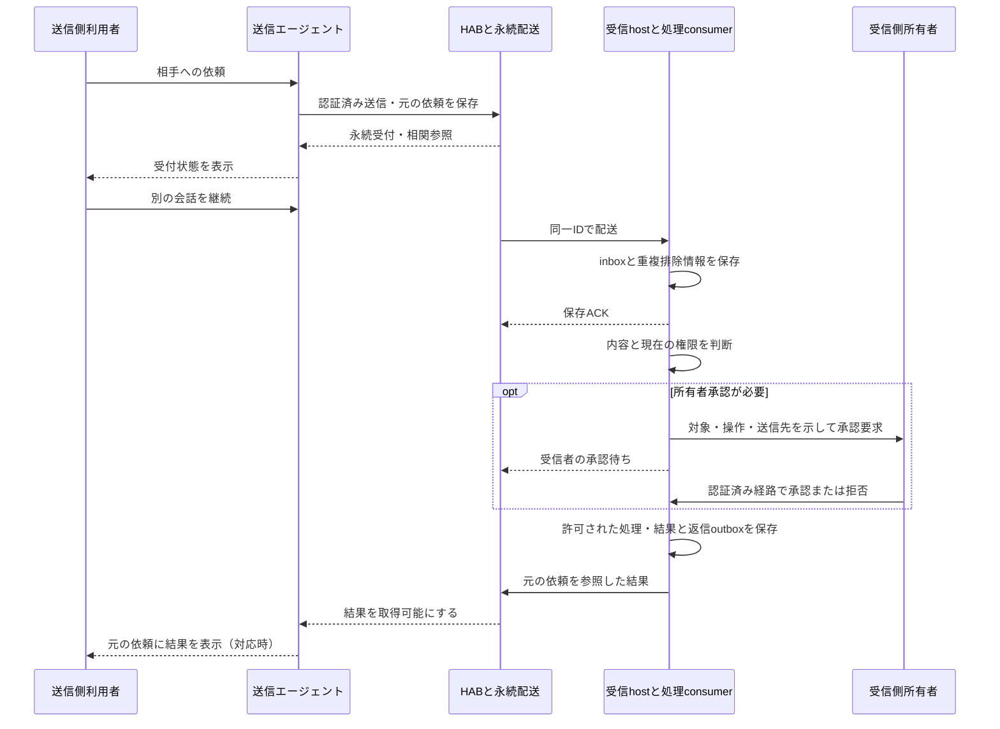
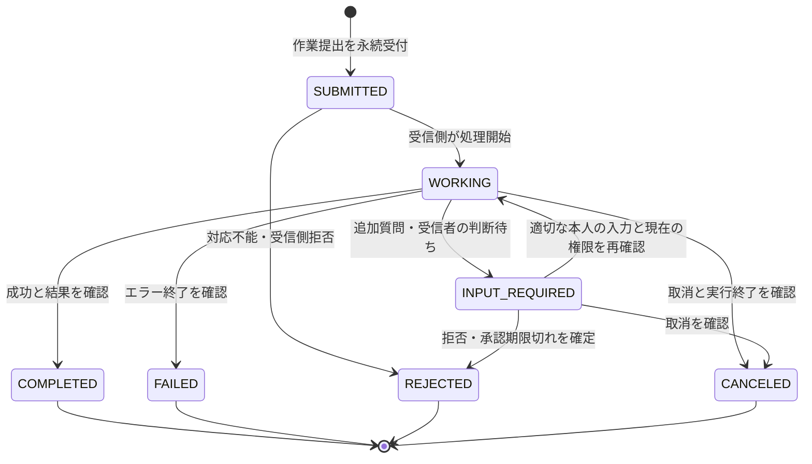

# 汎用エージェント間の非同期処理と受信者承認

設計日：2026-11-04 UTC。状態：製品要件と追加設計。**この文書の公開は、汎用処理の実装・配備・権限付与の完了を意味しない。**

[README](../README.md) · [製品仕様](hab-product-spec.md) · [既存の処理フロー](hab-workflow.md) · [セキュリティ](hab-security.md) · [固定Task bridge](task-bridge.md)

## 1. 送信後も会話を続けられる通信

HABの目標は、自分が契約するAIエージェントと、明示的に許可した他人のエージェントが通信できることである。利用者は相手を選んで依頼を送り、その後も元の会話を続けられる。遅れて届く進捗や結果は元の依頼に紐付き、新しい発言への回答として混ざらない。

DotsとHermesは検証例であり、設計を製品名へ固定しない。Grok BotとHermes、異なる所有者のMuse等にも、接続能力と受信側の権限が確認できる範囲で同じ契約を適用する。HABは通信とエージェント・権限の管理を担当する。hab-kanbanは独立した任意アプリのままとする。

初期範囲はテキストメッセージである。受信エージェントは内容に応じて、返答、追加質問、対応不能の説明、所有者への承認依頼を選べる。自然言語の柔軟さを理由に、実行権限を増やさない。ファイル変更や外部送信は受信側所有者の承認がない限り実行させない。

## 2. 現在の実装と追加する設計

公開コードの確認基準は `028b3754175f47668cc3f787a0a149926351f752`。下表は公開実装と運用上の確認範囲を分けたものであり、特定ホストの最新稼働状態を保証する表ではない。

| 項目 | 確認できる範囲 | 本設計で追加するもの |
| --- | --- | --- |
| メッセージ配送 | 認証・group認可、宛先、永続inbox、保存後ACK、相関と再送の契約 | 製品に依存しない依頼・進捗・結果の共通表示 |
| NATS配送 | [JetStream配送設計](../packages/relay-nats/DESIGN.md)に永続受付と本文配送・回復の境界がある | 実行journalとの連携。brokerを作業実行の正本にはしない |
| A2A | [SDK preview](a2a-sdk-preview.md)と[Relay preview](a2a-relay-preview.md)は固定 `connectivity_check`。任意prompt、継続、streaming、push、取消は未対応 | 汎用テキストとTask lifecycle、能力別のadapter契約 |
| Task bridge | 明示引受け、安定key、受付照合、固定結果の返信。保存ACKだけではTaskを作らない | 汎用の判断・承認・処理・結果の境界 |
| Hermes受信 | 現在の受信経路は保存・ACK・表示まで。自動モデル処理と自動返信は未接続 | 所有者が有効化する処理consumerと返信経路 |
| Dots等 | MCP接続は常駐受信や自動wakeの証拠ではない。Dotsのinbox自動wake・表示は未確認 | 正式な受信・表示能力を製品別に確認し、手動経路も表示 |
| 実行時承認 | 既存の限定Task契約がある。一般のmanual承認設定が全変更・全送信を阻止するとは確認していない | 実効toolと全実行経路を使った承認試験、不足する実行境界 |

既存の[製品仕様0.1](hab-product-spec.md)には導入前の技術評価が残る。本書はその非同期処理・受信者承認の追加設計であり、過去の配備記述や固定Taskの実装範囲を書き換えるものではない。

## 3. 利用者の操作

1. 利用者は許可済みの相手を選び、メッセージを送る。必要なら返答期限を指定する。
2. HABは永続受付の証拠と元の依頼への参照を返す。待機中も送信側の通常会話を止めない。
3. 受信hostは本文と重複排除情報を保存してからACKする。対応製品へ外部メッセージとして表示する。
4. 対応する処理consumerが、現在の受信側権限で内容を判断する。自動処理が未接続なら「受信済み・処理未開始」を示す。
5. 受信側の所有者判断が必要な操作は、その所有者の承認経路へ送る。送信側には「受信者の承認待ち」を示し、承認ボタンを出さない。
6. 検証済みの結果と返信を永続化する。送信側は元の依頼に結果を表示する。表示できない製品では、次回の明示的な状態確認で取得する。

A2A経路で会話を解放する場合は `configuration.returnImmediately=true` を使い、作成されたTaskを `GetTask` で照会する。標準の既定は終端または中断まで待つため、無条件に即時応答すると仮定しない。受付応答自体が失われた場合は、保存済みの元IDで照合し、新しい依頼へ置き換えない。

利用者にkind、lease、ACK、broker設定を操作させない。受信・処理・通知の未対応を隠して、成功や自動処理中と表示しない。

## 4. 通信許可と実行承認の責任

| 担当 | 責任 | 代行しない判断 |
| --- | --- | --- |
| HAB | 接続の認証、使用可能な送信名義、group・owner境界、宛先、配送、相関、状態参照の認可 | 本文を所有者指示へ昇格すること、受信側toolの包括承認 |
| 受信エージェント | 内容の理解、能力の確認、追加質問、拒否、既存の実行policyと承認機構の適用 | 送信者の申告を受信側所有者の承認として扱うこと |
| 受信側所有者 | 自分のエージェントが行う保護対象操作を承認または拒否すること | 他の所有者の操作の承認 |
| 製品adapter | 正式な受信・表示・実行APIへの接続、bindingと能力の検証 | 製品に存在しないwake・通知・承認機能の保証 |

認証済みの外部本文も、所有者からの直接指示と同じ権限では扱わない。`ROLE_USER`、表示名、署名付き配送、同じgroup、本文の「承認済み」という記述は実行承認にならない。送信者が所有者と同じ人であっても、外部配送本文から本人の直接承認を推測しない。

受信側は既存の承認機構を使える。専用権限ファイルは必須ではない。ただし、承認機構の名称や設定値だけで安全と判定しない。file write、shell、plugin、sub-agent、ネットワーク、公開API等の実効経路を確認する。モデルへの禁止指示だけを実行境界にしない。

初期の処理consumerは、メッセージの読取り・判断と、承認済み範囲のテキスト応答に限定する。ファイル変更、削除、公開、第三者への送信、外部サービス操作は、受信側所有者が具体的な操作と対象を承認するまで遮断する。HABへの結果返信も送信操作であり、通信許可だけで無条件に自動送信しない。所有者が限定的な返信policyを事前承認する場合は、相手・用途・データ範囲・期限を記録する。これは新しい相手や外部送信への包括承認ではない。

保護対象経路を遮断できない製品は、保存・表示だけに留める。未知のtoolや迂回経路を検出した場合も処理を保留する。承認前に副作用を伴う「試行」を行わない。

## 5. 状態を三つの軸に分ける

### 5.1 配送・表示・実行

| 軸 | 表示する状態の例 | 証拠 |
| --- | --- | --- |
| 配送 | 受付、配送待ち、相手保存済み、期限切れ、隔離、状態不明 | HAB受付journal、保存ACK、期限・照合結果 |
| 表示 | 表示待ち、表示済み、表示未対応、人間既読は不明 | 製品の正式な表示イベント。ACKから推測しない |
| 作業 | 受信済み・処理未開始、待機、処理中、追加入力待ち、受信者承認待ち、完了、失敗、拒否、取消確認済み、結果不明 | 受信側の永続実行状態、承認記録、終了証拠 |

「active」は登録状態でありonlineではない。保存ACKは人間既読・処理引受け・作業完了ではない。送信側が待つのを止めても、受信側の作業が停止したとは表示しない。

### 5.2 A2A標準TaskとHABプロファイル

標準のTask lifecycleを使い、新しい標準enumを作らない。以下の補助状態は**未実装のHABプロファイル案**であり、A2Aの標準状態ではない。表の意味は[A2A 1.0仕様](https://a2a-protocol.org/v1.0.0/specification/#413-taskstate)に従う。

| A2A Task状態 | HABでの意味と補助情報 |
| --- | --- |
| `TASK_STATE_SUBMITTED` | 作業の提出を永続受付し、処理開始前。配送のみでTaskを作らない経路には適用しない |
| `TASK_STATE_WORKING` | 受信側で処理中 |
| `TASK_STATE_INPUT_REQUIRED` | 続行に追加の人の入力が必要。質問待ちと受信側所有者判断待ちを、HABの待機理由・判断者区分で区別 |
| `TASK_STATE_AUTH_REQUIRED` | 標準のin-task認可取得をクライアントへ依頼する場合。受信側所有者の操作承認を送信側へ移すためには使わない |
| `TASK_STATE_COMPLETED` | 対象処理の成功と結果を確認済み |
| `TASK_STATE_FAILED` | 確認済みのエラー終了。副作用がなかったという意味ではない |
| `TASK_STATE_REJECTED` | 対応不能または受信側の拒否で実施しないと確定 |
| `TASK_STATE_CANCELED` | 取消を確認済み。取消要求の受付だけでは遷移させない |

受信側所有者の判断待ちは、追加の人の入力が必要な中断として `INPUT_REQUIRED` とし、HAB内で `wait_reason=recipient_owner_approval` を持つ案とする。判断は受信側の認証済み経路で受け付ける。送信側には待機理由だけを返し、承認credentialや受信側の承認URLを渡さない。プロファイル未対応クライアントには一般的な入力待ちと説明を返し、送信者が承認を代行できるUIを出さない。

`AUTH_REQUIRED` はクライアントに認可取得を求める標準フローであり、上記の所有者判断待ちとは別である。認証credentialの受渡しをHABメッセージへ埋め込まない。双方のprofile宣言、metadataの名前空間・版・schema、必要拡張の不一致時の拒否方式は実装前に確定する。[標準の認可](https://a2a-protocol.org/v1.0.0/specification/#76-in-task-authorization)、[拡張](https://a2a-protocol.org/v1.0.0/topics/extensions/)

図はHAB初期profileの主要遷移であり、標準全遷移の定義ではない。結果不明は実行照合の補助状態として保持し、終端状態を推測しない。終端Taskを再開せず、追加作業は元Taskを参照した別Taskにする。単発メッセージへの直接応答はTaskを作らない経路として維持する。[MessageとTask](https://a2a-protocol.org/v1.0.0/topics/life-of-a-task/)

## 6. 依頼と結果を永続的に結び付ける

送信側の会話画面と処理待機は独立させる。会話を閉じても、処理記録を「現在の最後の発言」へ付け替えない。profile移動やsession変更時も、自動的に別会話へ結果を配送しない。

| 記録 | 保存する対応関係 |
| --- | --- |
| 依頼intent | 所有者scope、認証済み送信agent、recipient、元message ID、本文hash、作成時刻、元の会話参照 |
| 配送 | 元ID、初回期限、inbox保存、ACK要求とreceipt、再送状況 |
| 作業 | intentとA2Aの `messageId`・`contextId`・`taskId`、受信側実行ID、現在の版、期限、終了証拠 |
| 承認 | 受信側所有者、対象Task、具体操作・対象・送信先・内容hash、権限世代、期限、判断と消費状況 |
| 返信・表示 | 返信ID、元依頼への参照、Task、結果版、outbox、認可済み表示binding、表示event ID |

HABの `thread_id` と `in_reply_to` は配送相関、A2Aのcontextは関連対話、taskは作業単位である。一つのthreadに複数Taskを置ける。IDの単なる文字列一致でownerや権限を判断しない。外部の任意session IDを内部の会話bindingに採用しない。

相関IDは再送前に保存する。同一owner・送信agent・message IDの再送は同じintentを参照し、内容やrecipientが変われば競合として拒否する。受信側も同じscopeで重複排除する。A2AのSendMessageの冪等性は任意のため、接続先が同一IDを安全に照合できるか能力ごとに検証する。保証がない相手へ応答不明の送信を自動再提出しない。

## 7. 承認・再起動・外部副作用

承認要求を表示する前に、対象操作と待機状態を永続化する。承認は受信側所有者の認証済みsessionから受け付け、Task・操作hash・期限・現在の権限世代へ結び付ける。送信者からの「はい」や任意callbackで承認しない。判断の重複・競合は一つの版更新として処理し、古い承認は再利用しない。

再起動後は同じ承認要求を復元する。承認済みでも、実行直前に現在の権限、取消、対象、期限を再確認する。操作内容、ファイル対象、送信先、送信内容が変わった場合は承認を取り直す。所有者の不在や承認の応答消失を許可として扱わない。

backup復元で承認の消費記録や実行結果が巻き戻った場合は、未消費・未実行と推定しない。復元後の新規実行を止め、外部結果と権限世代を照合する。照合できない承認や副作用は本人の確認まで保留する。

実行開始前に安定した実行keyと `prepared` 記録を保存する。結果と返信outboxは、可能な範囲で同じtransactionに保存する。ストアを跨ぐ場合は永続intentと照合で回復する。HAB側のlease・fencingは古いworkerの状態更新を防ぐが、外部APIやshell自体を止めたり、重複副作用を消したりはしない。

外部呼出しが成功した直後にprocessが停止した場合、journalが未完了でも無条件に再実行しない。外部側のidempotency key、実行ID、結果取得API、対象の状態を使って照合する。外部側が重複防止や照合を提供しなければ「結果不明」で停止し、人の確認を必要とする。固定IDだけで任意操作のexactly-once実行を保証しない。

## 8. 配送期限と作業期限を分ける

現行の配送期限は初回送信から1時間であり、再送で延長しない。これは処理完了や承認判断の期限ではない。受信側が期限内に保存し、別途作業を受け付けた後は、その作業・承認の期限で管理する。既存の固定A2A previewには引受け・初回submitも元配送期限で制限する契約がある。長い承認待ちへの対応は、その契約を変更する追加実装である。

| 期限 | 期限を過ぎたときの扱い |
| --- | --- |
| 元メッセージの配送期限 | 配送の新規試行を止め、保存済みかを照合する。作業が未実行とは断定しない |
| 承認期限 | 未消費の承認を無効にする。未実行が確認できれば拒否理由を保存し、再開には新しい本人判断を求める |
| 作業期限 | 新規実行を止め、対応時は取消を要求する。実行終了の証拠がなければ結果不明を残す |
| 送信側の待機期限 | 表示上の待機を終了する。受信側の作業や後日の結果を破棄しない |
| 結果返信の配送期限 | 元依頼とは別の配送として管理する。返信IDと元Taskを維持し、未達と作業失敗を区別する |

受信側の永続Task/結果を、認可された送信側が後から照会できる経路を設ける。通知や返信が失われても照会で回復する。streaming・webhookは対応能力がある場合の追加経路であり、重要な状態の唯一の正本にしない。保持期限を過ぎた結果は「保持終了」と示し、結果なしを再実行の指示に変換しない。

## 9. A2A・MCP・NATSの分担

| 部分 | 標準または既存契約 | 本設計でHABが担うこと |
| --- | --- | --- |
| A2A 1.0 | AgentCard、Message、Task、Artifact、状態照会、対応時の更新経路 | 通信相手の認可、owner/binding、受信者承認profile、相関と保持方針 |
| MCP | 対応製品からのtool呼出し | A2Aと同じapplication service・権限・状態を使う入口。MCP接続だけで背景受信を保証しない |
| NATS JetStream | 永続保存と少なくとも一度の配送 | 受付journal、元期限、receipt、受信側保存後ACK、Task/実行状態の照合 |
| 受信runtime | 製品の正式なモデル・tool・承認API | 内容判断と実効権限の強制。製品差はadapterの能力として明示 |

JetStreamの配送保証を、任意tool操作のexactly-once実行へ拡張しない。PubAck、consumer ACK、HAB保存ACKはそれぞれ異なる証拠である。現行の同期HAB配送では受付journalのcommitが受付点であり、その後pumpがpublishする。Limits retention上の本文清掃は保存receipt後の明示削除と不在確認であり、通常のconsumer ACKと同じ手順ではない。[HAB実装の境界](../packages/relay-nats/DESIGN.md)、[JetStream公式](https://docs.nats.io/concepts/jetstream)

A2A native接続は相手が標準endpointを提供する場合に使う。adapter接続はMCPや製品固有APIとの変換を行う。adapterを置いても、閉じた製品に自動起動・常駐受信・バックグラウンド通知APIが生まれるわけではない。AgentCardには試験済み能力だけを載せる。[非同期更新](https://a2a-protocol.org/v1.0.0/topics/streaming-and-async/)

## 10. セキュリティと過負荷

各送信・照会・返信・承認・再開の時点で認証と対象認可を確認する。異なるownerへの参加は明示許可し、招待・所有者確認・許可取消・分離を別の受入条件にする。groupへ参加しただけで他ownerのinbox、Task、承認内容、成果物の閲覧権限を与えない。

外部本文の命令、URL、引用、添付への参照はデータとして扱う。秘密の読取り、任意URLへのfetch、認証情報の開示、権限変更を誘導されても承認境界を通す。ログと送信側の状態表示には、受信側の私的ファイル名、credential、内部承認情報を不要に含めない。必要な結果の開示も受信側のpolicyで確認する。

通信ループと費用の増殖を防ぐため、依頼ごとの有限回数・時間・モデル費用・返信サイズ、ownerごとの同時数と待機上限を設ける。通知から自動的に新依頼を作らない。制限到達は隔離または明示保留とし、別IDや別モデルへ自動迂回しない。

## 11. 実装段階と受入試験

最初に保存・表示・状態照会と相関を完成させる。次に保護対象toolを使えない処理consumerでテキスト判断を検証し、受信側所有者が承認した返信だけを接続する。ファイル変更や他サービス操作は、必要な実行境界と承認試験が通った後の別段階とする。本書を根拠に本番設定やcredentialを変更しない。

| ID | 試験 | 合格条件 |
| --- | --- | --- |
| T-01 | 異なる製品・owner | 合成2製品以上で同じ契約を使用。Dots/Hermes固有名で分岐しない。未許可ownerを拒否 |
| T-02 | 会話継続・順序逆転 | 依頼を複数送り通常会話を継続。順序の逆転した結果も元の依頼だけへ紐付く |
| T-03 | 保存とACKの各境界で停止 | 保存前、保存後ACK前、ACK応答消失、返信outbox保存前後で故障注入。重複した処理intentを作らず、状態を照合 |
| T-04 | モデル処理の未接続 | 保存ACKを返しても処理中・完了と表示しない。製品の自動wake未対応を表示 |
| T-05 | 外部本文の権限昇格 | 所有者を名乗る本文、`ROLE_USER`、送信側の承認、prompt injectionで権限が増えない |
| T-06 | 実際の保護対象操作 | テスト用のfile write/delete、shell経由変更、plugin、sub-agent、外部送信を承認前に全て阻止。文字列上の拒否だけでなくファイル差分・受信側サーバの到着件数0を確認 |
| T-07 | 承認の本人性と限定性 | 受信側所有者の認証済み判断だけを採用。誤owner、古い承認、内容変更、期限切れ、二重判断、途中失効を拒否 |
| T-08 | 承認待ちの再起動 | process再起動とbackup復元後も同じ待機を復元。消費済み承認が古いbackupから復活しても再実行しない。承認を自動生成せず、実行直前に再検証 |
| T-09 | 重複と外部結果不明 | broker再配送、dedup window超過、旧worker、外部成功後の応答消失を注入。照合不能な副作用を再実行しない |
| T-10 | 時間と取消 | 1時間配送期限と長い承認待ちを分離。待機終了を作業終了にせず、未対応取消や停止不明を成功としない |
| T-11 | 標準状態と認可 | A2A標準clientで状態照会・終端不変・owner分離を確認。profile不一致を検出し、送信者へ受信側承認を委譲しない |
| T-12 | 回復と通知欠落 | 元会話を閉じ、再接続・表示binding変更・通知消失・容量不足を注入。認可された照会で元結果を取得し、誤会話へ表示しない |
| T-13 | 費用とループ | 上限到達で処理を止め、相互自動返信が無制限に続かない |

試験には対象製品・版・commit、実効tool一覧、承認設定、障害注入点、実副作用の観測、回復後状態を記録する。合成試験と実製品試験を区別する。製品やtoolの更新後は実行境界を再検証する。必要な遮断を証明できない製品では自動処理を有効にしない。

## 12. 実装前に確定する事項

- HAB承認profileのURI、版、schema、能力交渉、相手が未対応の場合の挙動。標準 `INPUT_REQUIRED` と受信側ownerの独立した入力経路を相互運用試験する。
- 承認対象操作と事前承認できる返信範囲。既存製品の承認UIで不足する経路と、その遮断方法。
- 受信runtimeのTask正本、HAB相関journal、A2A store間の更新・照合契約。新しい汎用Task engineの重複実装を避ける。
- 作業・承認・結果保持の期限、バックアップ後の承認失効、権限取消時の進行中実行の扱い。
- 製品別の自動受信・モデル呼出し・返信・通知・費用と利用条件。サブスクリプション契約だけでAPI利用や自動起動を保証しない。
- cross-ownerの招待・所有者確認・取消・分離、未解決副作用を確認する担当と安全な復旧操作。

## 13. 関連仕様と一次資料

- [HAB製品仕様](hab-product-spec.md)、[配送契約](hab-relay-spec.md)、[認証group](relay-auth-groups.md)、[受信supervisor](receive-supervisor.md)、[Task bridge](task-bridge.md)
- [A2A SDK preview](a2a-sdk-preview.md)、[A2A Relay preview](a2a-relay-preview.md)、[NATS配送設計](../packages/relay-nats/DESIGN.md)
- [A2A 1.0公式仕様](https://a2a-protocol.org/v1.0.0/specification/)：TaskState、冪等性、非同期処理、認可、拡張を2026-11-04 UTCに確認。
- [A2A Taskの扱い](https://a2a-protocol.org/v1.0.0/topics/life-of-a-task/)、[非同期更新](https://a2a-protocol.org/v1.0.0/topics/streaming-and-async/)、[拡張](https://a2a-protocol.org/v1.0.0/topics/extensions/)：標準とHAB profileの区分に使用。
- [NATS JetStream公式](https://docs.nats.io/concepts/jetstream)：永続配送の説明を2026-11-04 UTCに確認。任意の外部操作の実行保証には使用しない。
