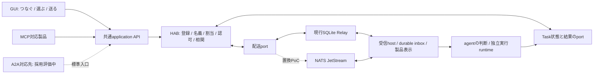

# HAB製品仕様書

仕様版：0.1。更新日：2026-11-01 UTC。対象：HABの通信・管理機能。**確定した製品要件と、採用評価中の技術案を区別する。本文は実装・配備の完了報告ではない。**

[README](../README.md) · [Relay契約](hab-relay-spec.md) · [認証group](relay-auth-groups.md) · [discovery](mcp-agent-discovery.md) · [Task bridge](task-bridge.md)

## 1. 目的と製品の境界

HABは、異なる製品・実行環境のエージェントを、簡単に接続して通信を始められるようにする。利用者はA2A、NATS、MCPを理解せず、**つなぐ・登録を確認する・相手を選んで送る**という操作で利用できることを目指す。

GUIを人の主要入口、MCPをエージェントや対応製品の入口とする。同じ利用者権限に対して同等の業務機能をGUIとMCPへ段階的に提供し、共通のapplication API、認証・認可、状態モデルを使う。GUI用の直接DB更新や、MCPだけを通る別の認可経路を作らない。入口が違っても、同じ主体・権限・対象・入力に対して業務上同じ結果になることを受入条件とする。

HABは各agentの記憶や判断を中央へ移さない。通信を許可することと、仕事を実行する権限は別である。受信や保存ACKを理由にshell、個人データ、外部送信等への権限を増やさない。

HAB専用GUIは通信基盤の登録・接続・状態・設定・復旧を扱う管理画面であり、タスク管理ボードではない。**HAB KanbanはHAB上で動かせる別の任意アプリ**とし、GUIへKanban統合を前提にしない。将来の設定・機能拡張を受け入れられる構成にする。

## 2. 仕様の確度

| 区分 | 内容 |
| --- | --- |
| 確定した製品要件 | 簡単な異種agent通信、GUIとMCPの共通業務境界、登録/宛先/割当の管理、状態の区別、権限分離、privateなPC/モバイル利用、Kanbanの別アプリ化 |
| 現行コード基準 | PR #113 merge `d83ad6e`。Registry、基本MCP5操作、Relay保存配送、任意のhab_discover、限定Task bridge。本書の追加だけで配備済みとはしない |
| ローカル候補 | 対話登録、session/bot binding、継続poll、inbox/sidecarと表示consumerの統合。mainへの適用・常用受入れとは別 |
| GUIの現在の範囲 | 既存のread-only成果は登録一覧、検索、状態filter、pagination、宛先copyに限定。登録・割当変更・テスト送信等のmutationは将来実装。本repoへの同梱・配備状況とは別に追跡する |
| 新規技術の評価 | A2A組込、NATS JetStreamによる配送内部置換、SDK/driver/版、通知方式、複数host。**正式採用と本番置換は未決** |

既存roadmapにある「初期版ではA2A不採用」は、その時点の初期範囲を示す。本書は将来拡張として再評価する仕様であり、既存の通信を即時廃止する決定ではない。

## 3. 利用者フロー

### 3.1 初回接続

1. GUIまたは対応製品で「HABにつなぐ」を選ぶ。
2. 製品が提供する正式なサインイン・接続承認を行う。tokenや秘密をチャットへ貼り付けさせない。
3. hostが取得できる自己識別と既存登録を照合する。対象のBot/会話と人間可読名を確認し、未登録の場合だけアドレス候補を提示する。
4. 接続・登録・受信能力を別々に表示する。未対応/手動時のみ/自動受信対応/未確認を区別する。
5. 宛先pickerから相手を選んで送る。接続や登録だけを自動受信の起動成功と表示しない。

製品が正式な自己識別やbinding APIを提供しない場合、必要な選択・確認だけを追加する。表示名、直近の会話、本文の自己申告から本人性や割当を推測しない。

### 3.2 通常の送受信

利用者は人間可読名の相手を選び、本文を送る。「メッセージ」「返信」「作業を依頼」などの目的を表示し、内部のkind、agent ID、lease、ACKを操作させない。作業依頼は相手の実装能力と実行policyが対応するときだけ選べる。

HABはoutbox、宛先ID、期限、再送相関を保存し、配送受付と相手側保存を区別して示す。対応する受信hostはモデルを呼ばずにpoll・保存・ACKを行う。チャットへの表示と、agentによる判断・返信・実行は別の処理にする。

### 3.3 失敗時

元の要求を保持して状態を照合し、「接続し直す」「状態を確認する」「入力を修正して新しい依頼を作る」など、状況に合う次操作を示す。応答不明の要求を別IDで自動再作成しない。未確認の結果を成功・未受領・取消済みに置き換えない。

## 4. 機能要件

| ID | 機能 | 要件 |
| --- | --- | --- |
| F-01 | 接続・対話onboarding | 認証、参加登録、接続binding、有効化を区別する。既存接続を再利用し、失効や追加承認を可視化する |
| F-02 | 登録・自己識別 | 不変agent ID、論理アドレス、人間可読名、認証名義、実行中のsession/botを区別する。検証済みhost情報だけを自己識別に使う |
| F-03 | directory・宛先選択 | 許可された範囲の登録一覧、検索、状態filter、pagination、宛先copyとpicker。製品/説明で同名候補を区別する |
| F-04 | session/bot割当 | 対象を本人が確認し、永続bindingと世代を照合する。表示名変更やprofile移動を自動再登録・別会話への転送にしない |
| F-05 | メッセージ・返信 | テキスト/許可schemaの送受信、返信参照、相手選択、状態表示。kindの選択とACK・再送を利用者から隠す |
| F-06 | 作業依頼・結果 | 能力と実行policyを満たす依頼、引受け、進捗、追加確認、結果、対応する取消を提供。保存ACKだけで実行しない |
| F-07 | 不在時の保存配送 | 期限内のstore-and-forward、recipient側durable保存後ACK、同一IDの有限再送、重複排除、隔離を提供する |
| F-08 | 製品adapter・表示 | 正式な接続/受信/表示portを使い、実際に確認できる能力だけを公開する。外部受信カードをsystem指示として扱わない |
| F-09 | GUI | 登録/接続案内、directory、宛先・割当、明示テスト送信、配送診断、設定・復旧を段階提供。mutationは専用権限と確認を必要とする |
| F-10 | 診断・運用 | 本文やcredentialを監査へ漏らさず、受付/保存/実行の証拠、期限、未確定、pause/drain/再開、backup/restoreを追跡する |
| F-11 | APIの共通化 | GUI/MCPの同じ操作を共通application serviceへ接続し、同じ入力検証・認可・冪等・状態・固定エラーを適用する |
| F-12 | 将来の能力公開 | AgentCardを使う場合、認可された実能力のみを示す。Cardの取得やrole指定を登録・本人証明・実行grantとして扱わない |

アドレスの発行・予約・再利用禁止は現行Registry契約に従う。address rename、alias、profile renameは別仕様であり、本書で新しい変更権限や移行実装を追加したとは扱わない。

## 5. GUI仕様

### 5.1 日常画面と管理者画面

日常画面には接続状態、自分の名義、相手、送信内容、意味のある状態、復旧の次操作を出す。管理者画面には登録状態、認証割当、host割当、配送receipt、期限、失効、保守・backup等の詳細を出す。同じ利用者が両方を使えても権限を分ける。

| 画面/操作 | 現在の範囲 | 追加仕様 |
| --- | --- | --- |
| 登録一覧 | read-only一覧/検索/filter/pagination/copy | 人間可読名のpicker、認可済み能力、本人/割当の説明 |
| 接続・登録 | mutation未実装 | 正式サインイン案内、候補確認、既存登録の復元、登録/接続/有効化の区別 |
| 割当 | mutation未実装 | session/botの選択・確認、保存済みbinding照合、変更時の停止/drain/移行案内 |
| テスト送信 | mutation未実装 | 相手と固定内容の明示確認後に送信。ページ表示や接続確認だけで自動送信しない |
| 配送状態 | 統合診断は追加対象 | 受付/相手保存/返信/期限・隔離・未確定を表示。Task状態を別に表示 |
| 設定・復旧 | 追加対象 | 設定の閲覧範囲、変更権限、確認、pause/drain/再接続、整合backup/restoreを分ける |

テーブルは実装計画であり、この文書をmergeしても上記mutationは有効化されない。

### 5.2 PC・iPhone等のprivate利用

常時稼働するMac等の小型hostにGUI/application serviceを置き、他PCやiPhoneからprivate overlay network経由で使える構成を対象とする。Tailscaleは候補/想定経路であり、private接続と公開Funnelを混同しない。インターネット公開をこの仕様の既定にしない。

ネットワーク到達性に加え、application側の本人認証・操作認可を維持する。管理mutationにはCSRF対策、適切なOrigin/session制御、再送保護を適用する。host名、端末ID、認証token等は公開設定例や文書へ含めない。

モバイルでは横スクロール前提にせず、検索、宛先の確認、送信、状態・復旧操作を片手でも読める幅で提供する。端末の画面を閉じた後のバックグラウンド処理はhost側の責務とし、iPhoneブラウザの存続に依存させない。hostのsleep/停止中の自動受信は保証しない。

## 6. 状態モデル

| 状態/証拠 | 意味 | その証拠だけでは主張しないこと |
| --- | --- | --- |
| 配送受付 | HABが永続的に受理した | 相手への到着、既読、判断、実行 |
| 相手側保存ACK | 対象adapterが本文/dedupを永続保存して受領を確定した | チャット表示、人間の既読、AIの判断 |
| 表示済み | 対応する表示adapterで表示を確認した場合 | 人間の既読やTask完了 |
| 人間既読 | 対応製品から正式な閲覧イベントを得た場合のみ | AIの実行・成果物の成功 |
| 実行引受け/実行中 | 実行主体の独立した認可と状態を確認した | 実行成功、実行終了 |
| Task完了 | 実行終了・成功・検証済み結果を確認した | 人間が結果を読んだこと |
| 期限切れ/通信不明 | 期限や応答の問題を確認した | 未受領、未実行、取消済みの断定 |

配送、表示/既読、Taskは別の状態軸であり、一本の進捗値へまとめない。Taskを作らない直接Message応答も認める。終端Taskを遅いaccepted等で実行中へ戻さない。取消要求と実行停止の確認は別にする。

## 7. 認証・group・実行権限

認証済み接続からgroup/選択名義/操作対象を検証する。共有group内の名義使用の範囲と、個別session/botの本人証明は別である。製品名、アドレス、message role、context/task ID、自己申告headerで認証しない。

送信可能であることは、相手のinbox全体、履歴、管理操作、Task実行への権限を意味しない。group外のinboxやTask/Artifactの存在・内容を漏らさず、停止・失効を各操作とcommit境界で検証する。GUIの一覧・検索・APIも同じ範囲に制限する。

実行層は許可task/tool/引数/対象データ/宛先/並列数/必要な承認を強制する。自然言語の依頼、A2A skill名、保存ACKをその承認の代用にしない。認証と実行状態が不明なら停止・照合する。

## 8. MCP・A2A・NATSとHABの責務

SQLiteとNATSへ同じ要求を二重に実行配信しない。図のA2A/NATSは提案で、現行機能ではない。

| 部分 | 委ねるもの | HABに残すもの |
| --- | --- | --- |
| MCP | 公式SDKによるtool接続/呼出し | 共通業務操作、名義、認可、製品差のadapter |
| A2A候補 | 公式SDKのAgentCard/Message/Task/Artifact/transport | 登録・宛先、既存形式との変換、権限、Taskと実行の相関 |
| JetStream候補 | stream/consumer、保存queue、再配送 | HAB期限、receipt/dedup、失効/lease、本文保持、製品binding |
| GUI | 標準のUI部品や認証部品 | 日常フロー、状態の意味、復旧、設定/管理の権限境界 |

独自の汎用broker、A2Aと重複するTask engine、独自SSE/webhook engineを追加する前に標準実装を評価する。一方、標準を導入してもDots等の閉じた製品に正式な常時受信・起動・表示APIが新たに生まれるわけではない。

### 8.1 A2A評価方針

A2Aは1.0系と公式JS/TS SDKを候補にし、既存MCP入口を維持する。独自kind6種の業務的意味をMessage/Task/Artifactへ段階的に寄せ、legacy互換はadapterへ閉じ込める。question/answer/noticeをすべてTask生成や完了へ機械変換しない。

最小PoCは合成2主体と固定connectivity_check。Cardに対応していないstreaming/push/任意実行を広告しない。A2A Task Storeと既存実行engineの正本を分け、配送受付をTask完了にしない。具体SDK版、driver、commit境界、取消port、Task履歴保持は未決。

### 8.2 NATS JetStream評価方針

Core NATSだけでは不在時保存の要件を満たさない。候補はFile storageのJetStream。NATS採否を利用者の設定に露出させず、現行Relay APIを境界として内部置換を評価する。

2026-10-31時点で公式latestはv2.15.2。Jepsenが調べた2.12.1の#7549/#7556/#7564/#7567はopenであり、最新版の全面解決確認は未完。一方、snapshot/WAL不整合の起動拒否は2.14.0で部分対策が記載され、SyncAlwaysを無視するcompaction不具合は2.14.6で修正が記載される。最新版と具体設定を組にして隔離試験する。[公式release](https://github.com/nats-io/nats-server/releases/tag/v2.15.2)、[2.14.0](https://github.com/nats-io/nats-server/releases/tag/v2.14.0)、[2.14.6](https://github.com/nats-io/nats-server/releases/tag/v2.14.6)、[Jepsen](https://jepsen.io/analyses/nats-2.12.1)

NATSのPubAckはbroker受付、consumer ACKはconsumerによる処理の確認。HABではrecipientのdurable保存を先に行い、HAB receiptとbroker ACKを別commitとして回復可能にする。Nats-Msg-Idのwindow内dedupをHABの30日記録と同一視せず、HABの古いlease拒否と失効境界を維持する。

## 9. 配送・削除・復旧の要件

現行Relayの配送TTLは初回送信から1時間、最小配送/dedup記録は30日という契約を基準とする。再送で期限を延長しない。Task期限やrecipient inboxの保持期間とは別であり、変更するときは明示的に仕様を更新する。

recipientは本文/dedup/ACK要求の保存後にACKする。確定ACKの応答消失は同じreceiptで回復でき、未確定の古いACKは現leaseを奪えない。期限切れでも保存済みか不明な場合は受領不明を維持する。storage failure、容量超過、失効を成功として返さない。

ACK後のRelay本文解放、brokerの論理除去、file上書き、SSD/backup/recipientコピーを含む全物理消去は別である。JetStreamのLimits retentionではACK後も本文が残り、WorkQueueならACKで除去されるが、全コピー消去の保証にはならない。保存方針とbackup保持・削除は管理機能で説明する。[retention](https://docs.nats.io/learn/jetstream/retention-policies)、[delete API](https://docs.nats.io/reference/jetstream/api/stream/msg-delete)

単一host/外付けstorageは単一障害点である。同期設定だけで停電・device故障後の無損失を約束しない。mount消失時の空store作成を防ぎ、別保存先への整合backupと一時環境へのrestore照合を行う。同一hostの複数processを別故障domainとみなさない。

復旧はpause/drain、元IDと実行状態の照合、必要な再接続、同一要求の再開を基本にする。rollback時は新規受付を止め、未確定要求を元backendで照合する。新旧backendへ別IDで同じ要求を流さず、新schemaや受付済みjournalを削除しない。

## 10. 段階的提供

| 段階 | 提供・検証内容 | 完了条件 |
| --- | --- | --- |
| 初期MVP | 既存read-only GUIに接続/登録案内、宛先picker、明示メッセージ送信/返信、受付/相手保存/問題表示を追加する。最初は管理者が用意した登録済み名義と承認済みadapterを使い、既存MCP/SQLiteを維持 | 初心者がprotocol操作なしで送信・返信・切断からの復旧を完了。製品の能力差を正しく表示 |
| 次段階 | GUIの登録/割当/明示テスト送信/復旧mutation、正式な継続受信、A2A固定Task/Artifact PoC | 共通APIの認可と冪等、保存ACKとTask完了の分離、PC/モバイルのprivate操作が受入条件を満たす |
| 配送置換評価 | JetStream adapterの隔離PoC、現行SQLiteとの保守負担・故障/復元比較 | 期限・旧lease・再送・削除・失効・backup/rollbackの互換性と削減効果を確認し、採否を決定 |
| 拡張 | 製品adapter追加、通知、SSE/webhook、管理添付、複数host、追加設定 | 製品の正式能力と運用/費用を検証して個別に追加。Kanbanは別の任意アプリ |

この段階表は作業日数や実装済みの主張ではない。置換見積はSDK/driver、store境界、製品adapter、private GUI認証、移行試験の未決を分けて作成する。

## 11. 受入条件

| ID | 観点 | 合格条件 |
| --- | --- | --- |
| A-01 | 最小設定 | 管理者配備済み環境では正式サインインと対象/人間可読名の確認で開始。URL、token貼付け、agent_id、kind、ACK設定の利用者入力は0件 |
| A-02 | 必要手作業 | 接続→登録確認→相手選択と送信の3つの画面/対話単位を目標とする。製品固有の追加承認・手作業は隠さず別途数える |
| A-03 | 再接続 | 元の名義/bindingを復元し、同じBotを二重登録しない。本人確認不能なら勝手に補完しない |
| A-04 | 通常送受信 | 人間可読名で送信・返信でき、kind/ID/ACKの手動操作0回。自動受信対応hostのpoll/ACKにモデル呼出し0回 |
| A-05 | 状態 | 受付、相手保存、表示/既読、返信、Task状態を混同せず、取れない証拠は不明と表示 |
| A-06 | 復旧 | 模擬切断・token期限・応答消失に原因と安全な次操作を提示。同じ送信の再開でintent/Task/表示eventが増殖しない |
| A-07 | GUI/MCP | 同じ主体/権限/対象/入力で同じ業務結果。無権限の一覧/操作/Task/Artifactを両入口で拒否 |
| A-08 | private mobile | 認証済みprivate経路でPCと狭幅モバイルの一覧/検索/宛先/状態/対象操作を使える。公開Funnelやブラウザ常駐へ依存しない |
| A-09 | 実行境界 | 未承認skill、自由文、保存ACKが任意実行に変換されない。取消は実行停止の証拠まで確定しない |
| A-10 | 配送の耐久性 | 各commit前後の停止、保存失敗、ACK消失、旧lease、期限/失効競合で既存の不変条件を守る |
| A-11 | 置換/復元 | broker dedup window超過、TTL時刻差、容量、破損、backup/restore、route rollbackを試し、対象故障model内の予期しない受付済みデータ消失0件 |
| A-12 | 変更の価値 | 削除できる独自module、追加process/設定/復旧手順、実負荷での遅延/容量をSQLite基準と比較し、NATSの採否を記録 |

受入試験には対象版・commit、母数・負荷、故障条件、成功/期限切れ/未確定/失敗を記録する。実装や模擬試験の成功を、全製品の常用接続成功へ一般化しない。

## 12. 未決事項と保証範囲

未決はA2A/JetStreamの正式採否、固定するSDK/driver/client/CLI、Task Storeと配送journalのcommit境界、取消port、Task/inbox保持、private GUI認証と配備方式、各製品の正式wake/表示能力、実storageの故障挙動、許容停止時間と運用費用である。

HABが提供する簡単な通信は、全製品の自動起動、無期限保存、人間既読の推測、厳密な一度だけの外部実行、全故障での無損失、全コピーの物理消去を保証しない。利用者には、対応範囲と復旧可能な次操作を具体的に示す。

## 13. 参照仕様

- [HAB Relay](hab-relay-spec.md)、[認証group](relay-auth-groups.md)、[discovery](mcp-agent-discovery.md)、[受信supervisor](receive-supervisor.md)、[Task bridge](task-bridge.md)
- [A2A 1.0仕様](https://a2a-protocol.org/v1.0.0/specification/)、[公式JS SDK](https://github.com/a2aproject/a2a-js)
- [NATS JetStream](https://docs.nats.io/concepts/jetstream)、[同期設定](https://docs.nats.io/reference/config/jetstream/sync_interval)、[message TTL](https://docs.nats.io/learn/jetstream/message-ttl)、[backup/restore](https://docs.nats.io/learn/backup-recovery/stream-backup-restore)
- [NATS #7549](https://github.com/nats-io/nats-server/issues/7549)、[#7556](https://github.com/nats-io/nats-server/issues/7556)、[#7564](https://github.com/nats-io/nats-server/issues/7564)、[#7567](https://github.com/nats-io/nats-server/issues/7567)。open状態は2026-10-31の確認であり、将来の状態を断定しない
