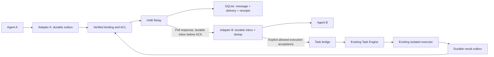
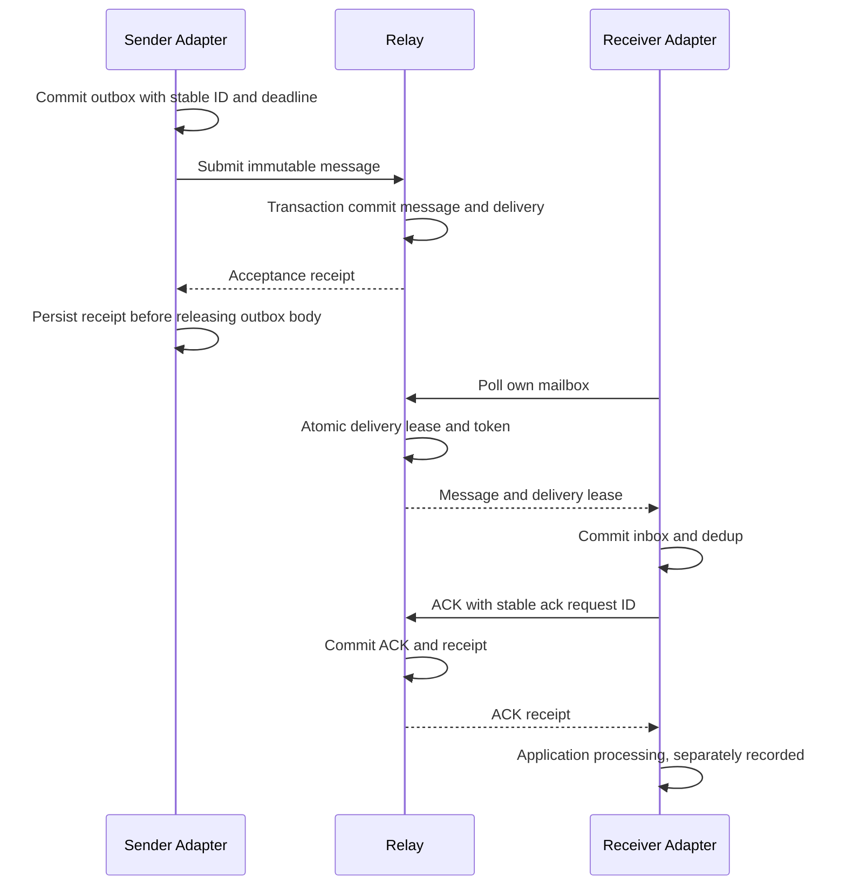
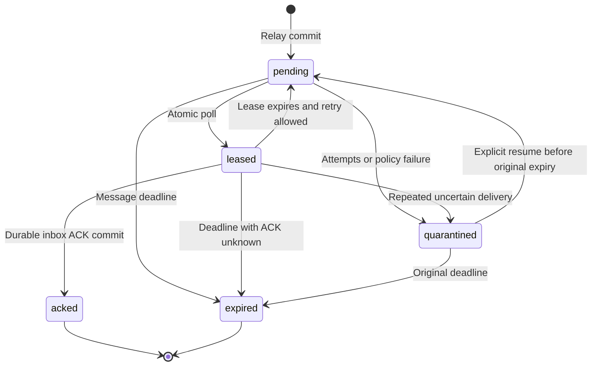
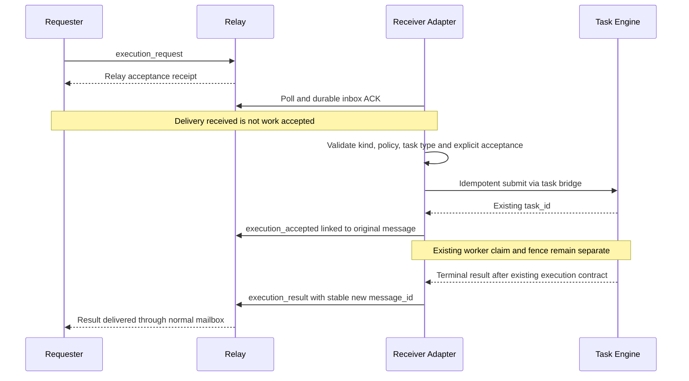

# HAB Relay 正式仕様 — draft v2 + store-and-forward

[README](../README.md) · [設計判断](hab-decisions.md) · [現行Hub内部設計](architecture.md) · [受入れ状況](mvp-acceptance.md)

| 項目           | 内容                                                                                                                   |
| -------------- | ---------------------------------------------------------------------------------------------------------------------- |
| 採用設計       | **HAB Relay draft v2 + store-and-forward**。draft v2は採用した設計案の名称であり、稼働済みのprotocol versionを表さない |
| 採用判断       | 2026-10-17 JST。正式な設計として保存する判断                                                                           |
| 実装照合基準   | `main` `70c438bb6f3f4ab8b201536e437cdb641eeee4d6`                                                                      |
| この文書の対象 | 通信部分のHAB Relay、周辺Adapter、既存Task Engineとの境界と受入れ条件                                                  |
| 承認の境界     | 設計採用は、実装・migration適用・実個体接続・サービス起動・公開・credential発行・権限変更の承認を兼ねない              |

**現在の3者本番E2Eは未完了であり、HABの公開診断入口は本人の待機指示により閉じたままである。** この文書は実行手順の実施報告ではない。Dashboardは対象外とし、その設定・プロセス・公開状態を変更しない。実設定、接続識別子、秘密、個人の本文、実運用ログは公開repoへ保存しない。

「必須」「禁止」は採用した設計の実装要件を示す。「推奨初期値」は未合意の設定案であり、実装開始時の確認と負荷試験が必要。「未検証」は実サービスで証明していないことを示す。追加予定の型・table・API・ファイル名は、明記のない限り**計画であり未実装**である。

実装状況：独立契約・認可port・SQLite配送store・送受信journal・明示的保守と、未配線のMCP 4 tool factoryをローカルの模擬接続で検証済み。実装範囲は[Relay実装手順](../src/relay/README.md)を参照する。実個体registry/認証binding、管理添付、本番HTTP MCP公開・3者接続は未完了であり、入力検証や模擬配送の成功を本番接続成功とは扱わない。

## 1. 目的と非目標

HAB全体の名称は **Hiraoku Agent Base**、通信部分の名称は **HAB Relay** とする。目的は、**拡張性・導入容易性・シンプルさ・安定性**の4つであり、順位は付けない。

メールから取り入れるのは、安定した宛先、非同期の保存・転送、不在時の蓄積、スレッド、返信参照、不達状態、送受信者の独立性である。SMTP自体は必須ではない。実メール、broker、A2Aは後から選べる追加transportであり、初期依存にしない。

初期構成は**単一Nodeサービス + SQLite**とする。同じプロセス内でもRelay、Task Engine、Adapter、認証・認可をコード上の責務として分ける。全agentの判断を中央に移すものではない。Dots、Grok Bot、Hermesなどの既存の担当・job・判断を尊重し、同じcron/jobを重複作成しない。

初期は1メッセージにつき1送信個体・1受信個体の1対1とする。broadcast、group、任意URL転送、任意shell、本文からの自動実行は初期対象外。質問・回答を送るだけならTaskは不要である。

## 2. 先行実証ゲート G0

実装の到達保証を述べる前に、実Grok／dotの**各個体**について次を実証する。製品の一般的な宣伝や、会話中の「送信した」「記憶した」という返答だけでは合格にしない。

| 確認点           | 必要な証拠                                                               | 利用できない場合                                                        |
| ---------------- | ------------------------------------------------------------------------ | ----------------------------------------------------------------------- |
| 個体識別         | 接続の検証済み情報を個体へ結び付け、同じ所有者の別個体を偽装できない試験 | 共有subjectだけで代用しない。接続単位を識別できる別方式の設計判断が必要 |
| 送信側outbox     | 送信前の永続保存、再起動後の同じID・同じ内容の再送                       | bridge到着後からの保証に限定し、agent起点の保証とは呼ばない             |
| 再送契機         | 応答消失・一時停止・復旧後に、誰がいつ再送するかを実行可能な形で示す     | 永続outboxがあっても再送契機がなければ自動回復を保証しない              |
| 受信側inboxとACK | 永続受領・dedup保存後のACK、再起動後の取得                               | 一時的な会話contextや画面表示を永続inboxと扱わない                      |
| poll／wake       | 対応API、呼出主体、有限timeout、権限、wake後のpollの可否                 | wakeは省略可。poll自体が利用不能なら接続設計を見直す                    |

**外部bridgeに届く前に発生した送信失敗を、そのbridgeが保証するとは言わない。** 原agent側の永続outboxまたは同等の証明がなければ、「bridgeが受け取った後」の保証のみである。個体専用credentialを必要とする場合も、この仕様書だけで発行しない。

G0はモデルなしのRelay核実装とは並行調査できるが、実個体対応の工数確約・本番接続受入れより先に完了させる。提供APIがなければ、単なる作業日数の追加ではなく、利用方法・bridge・対象製品を再選定する判断に戻る。

## 3. 構成と責務



| 責務        | 行うこと                                                           | 行わないこと                                     |
| ----------- | ------------------------------------------------------------------ | ------------------------------------------------ |
| Relay       | message/delivery保存、宛先検証、lease、ACK、再配送、期限・不達状態 | 本文の命令実行、Taskの自動claim、個体の判断代行  |
| Task Engine | 許可された固定Taskの受付・claim・heartbeat・complete・cancel・照合 | 会話mailboxの代用、配送ACKを仕事完了と解釈       |
| Adapter     | 共通契約への変換、永続outbox/inbox、再送、受領後の個体への橋渡し   | 自称agent名での認証、未保存ACK、到着前の送信保証 |
| 認証・認可  | 検証済み接続→agent_id、操作・宛先・kindの許可、停止と失効          | 本文・アドレス・製品名による権限付与             |
| Task bridge | 実行依頼の明示的引受けとTaskの一意な関連付け、結果の返信化         | 普通の質問・回答・受領ACKからの無条件Task生成    |

サービス内の直接呼出しでも、これらの境界を省略しない。wakeやpushに失敗しても、保存済みmessageとinboxを正本として回復できる構成にする。

### 3.1 再利用可能な独立コンポーネントとしての境界

メッセージ機能は、HAB以外にも組み込める独立したRelayコンポーネントとして設計・実装する。初期配備は単一Nodeプロセス＋SQLiteのままでよく、独立性のためだけにmicroservice、別repo、brokerを増やさない。コード、公開契約、永続状態の所有権を分離し、後から別package・別プロセスへ取り出せることを必須とする。以下は実装要件であり、分離済みという現状報告ではない。

| 境界                         | 所有するもの                                                                         | 依存してはいけないもの                                                                   |
| ---------------------------- | ------------------------------------------------------------------------------------ | ---------------------------------------------------------------------------------------- |
| Relay core／contract         | 汎用envelope、配送状態、dedup、lease/fencing、ACK、期限、容量制御、固定エラー契約    | HABの製品名、`.hab`命名規則、Task型・実行状態、MCP SDK、OAuth provider、UI、個別BotのSDK |
| Relay storage adapter        | Relay専用table、transaction、migration、receipt／tombstone／delivery audit           | Task tableへの直接SQL、HAB固有registryへのJOIN、client inboxを正本とする処理             |
| Client SDK／durable delivery | transport越しの送信・poll・ACK、送信outbox／受信inbox、再試行・回復                  | 特定agent製品、model、Task Engine、HAB登録画面                                           |
| HAB integration              | 半自動登録、アドレス解決、検証済み主体と個体のbinding、ACL・停止policy、設定の組立て | Relayの内部tableを直接更新して不変条件を迂回する処理                                     |
| Transport adapter            | HTTP MCPのschema変換、認証入力、request上限、共通service呼出し                       | 別の配送状態機械や独自のACK／再送規則                                                    |
| Product adapter／Task bridge | 製品APIへの受渡し、明示的な実行引受け、Taskとの関連付け                              | Relay coreからの逆依存、会話配送へのTask Engine必須化                                    |

依存は外側のHAB／transport／storage／製品adapterから、内側の公開contract・core interfaceへ向ける。runtimeのcomposition rootが依存を注入する。coreからHABのruntimeや製品adapterをimportせず、共有の巨大な型ファイルやservice locatorを介した隠れた逆依存も作らない。

Relayへ渡す送受信者はopaqueな個体IDとし、coreは`agent_name`、`bot_name`、`.hab`を解析しない。第4章のアドレス命名・登録はHAB側のpolicyである。別の利用先は独自のアドレス方式を使え、アドレスを表示しない利用も可能にする。`kind`ごとの業務的意味や本文の命令解釈は利用側が所有し、coreはversioned envelope、許可されたschema／サイズと配送上の不変条件を検証する。

認証・認可は省略可能な便宜機能にしない。HAB側の検証済み接続を、必須の認可interface経由でcoreへ渡す。coreはsubmit／poll／ACK／statusの各境界で許可と停止・失効を確認し、認可実装の未注入・不明主体・判定失敗は拒否する。policy側の即時失効と受付の整合性を保つversion／epoch契約を定義し、分離のためにstaleな許可を無期限cacheしない。raw credentialや自己申告senderをcoreの業務引数にしない。

storage、認可／宛先検証、clock、ID／lease token生成、redacted auditと任意wake出力は狭いinterfaceとして定義する。transaction内のmessage＋delivery＋receipt／audit保存は一つのRelay storage境界が所有し、interface分割を理由に原子性を壊さない。wakeや外部通知はcommit済みoutboxから実行する。時刻は一操作内で一つの正本を使い、テスト用clockと本番DB時刻の関係も契約化する。

Relayのmigration・schema version・設定namespaceはTask Engineから分離する。同じSQLiteファイルで共存しても、互いのtableへ直接アクセスせず、Task bridgeは公開APIと専用link journalで連携する。起動・migration適用は明示操作とし、package importだけでDB変更、listener起動、環境変数読取、外部接続を行わない。standalone構成は専用DBとcomposition rootのみで起動でき、Task Engineを導入しなくても送受信できる。

公開contractとstorage schemaは別々にversion管理する。MCP toolは薄いadapterとし、in-process利用や別transportでも同じ認可・状態機械・エラー契約を使う。package間は公開entry pointのみimportし、内部table・private型へ依存しない。具体的なpackage名・配置は実装時に決めるが、境界ごとの所有権と依存方向は変更しない。

## 4. 個体、アドレス、認証、ACL

### 4.1 Registry

各個体に、HABが不変で再利用しない`agent_id`を自動発行して登録する。`agent_id`は個体の内部識別子であり、製品・実行環境を表す`agent_name`とは別の属性である。同じ製品の複数個体は同じ`agent_name`を共有し、別の`agent_id`、inbox、ACL、停止状態を持つ。IDは認証秘密ではない。

HABの論理アドレスは、次の形式とする。

```text
<bot_name>@<agent_name>.hab

research@grok-bot.hab
stallone@dot.hab
backend@claude-code.hab
frontend@cursor.hab
review@codex.hab
lab@hermes.hab
```

例はダミーであり、実登録を示さない。`.hab`はHAB用の論理アドレスであることを識別する表記であり、SMTP配送先や外部DNSの名前解決には使わない。`agent_name`には製品・実行環境の識別しやすい固定名を使う。Grok Botは`grok-bot`とする。他製品の上記slugは候補例であり、正式な対応表は実装時に管理する。Claude Code、Codex、Cursorなども同じ登録・通信契約の対象であり、製品別に別の配送方式を作らない。

登録時にユーザーが自由に指定できるアドレス部分は`bot_name`だけとする。HABは選択した製品・実行環境の登録情報から`agent_name`を設定し、完成したアドレスを半自動で提案する。`bot_name`は識別しやすい個体名として使い、同じ製品内の個体を区別する。許容文字、長さ、大小文字・Unicodeの正規化とそのversionは実装前に固定する。

### 4.2 半自動登録と変更不可の境界

1. 本人が製品・実行環境を選択し、`bot_name`を指定する。同じ製品の追加個体では既存の製品情報・接続手順を再利用する。
2. HABが`<bot_name>@<agent_name>.hab`を提示する。確定前は`bot_name`を編集できる。既存・廃止済みアドレスとの重複は拒否し、無断で連番を付けて確定しない。
3. 本人の確定操作で、固定`agent_id`の発行とアドレスの予約を原子的に行う。登録操作自体の再試行で複数個体を作らないよう、登録要求のidempotencyを持たせる。
4. 登録直後は「接続待ち」とし、認証済みMCP接続を個体へbindingする。本人が有効化すると、第4.4節のHAB内相互通信policyを適用する。ペアごとの送信許可設定は要求しない。アドレス作成だけで送受信権限を与えない。

**登録確定後は`bot_name`、`agent_name`、完成したHABアドレス、`agent_id`を変更できない。** 別名alias、役割アドレス、転送先変更は初期登録仕様に含めない。別アドレスが必要なら別個体として新規登録し、旧個体は停止・廃止する。廃止してもIDとアドレスの再割当てを禁止し、必要な予約tombstoneを保持する。表示専用ラベルや説明はアドレスと分離し、その変更で配送先を変更しない。

送信側はアドレスを解決し、**最初のmessage送信前にrecipient_idをoutboxへ確定保存**する。Relay受付はそのIDと現在の許可を検証する。未解決の送信intentを先に永続化することはできるが、ID確定前のmessageは送信しない。再送時にアドレスを再解決せず、過去の配送先や保存済みoutboxを別個体へ付け替えない。宛先を変える意図がある場合は、元の送信状態を照合したうえで明示的な新messageとして扱う。

Grok Bot／dot等がHTTP MCPでHABへ接続できることを設計上の前提とする。製品固有の取得タイミング、自動起動、再試行、個体別認証bindingの実能力は実装段階で検証する。接続成功やdurable配送を確認済みとは表現しない。

### 4.3 検証済み接続と個体識別

認証済み接続とregistryのbindingから**serverがsender_idを確定**する。submitにsender_idを任意指定する機能は作らず、受信操作のagent_idも接続から確定する。

同一所有者のOAuth subjectだけで、Grok Botやdotの各個体を識別できると仮定しない。issuer/audience/subject/clientと、必要なら検証済みの接続識別子を組み合わせる。別client IDであっても、それが個体専有であることはG0で確認する。自己申告名、会話名、任意header、引数のagent_idは証明にならない。

bridgeしか識別できない接続はbridge個体として登録し、元Bot固有の認証を証明したとは言わない。利用可能な方式はG0の結果で決める。credential本体はregistryやmessageへ入れず、承認済み保管先への参照だけを設定する。

認可は第4.4節の明示的な相互通信policyと、個体状態・操作権限・block等を評価する。認可実装やpolicyが未設定なら拒否するが、有効個体間のペア別allowlistは要求しない。新しい個体登録、binding、有効化・停止、ACL変更は管理操作であり、通常の会話やAdapterの自己登録で昇格できない。停止・失効・epochを各受付／取得／ACKの境界で再確認する。他個体のinbox、status、thread、返信参照を推測しても読めないようにし、存在有無を権限エラーから漏らさない。

### 4.4 メール型の相互送信policy

HAB内の有効な登録エージェント同士は、宛先アドレスを指定してメッセージを送信できる。個体ペアごとの事前許可や受信側の引受け承認を、配送受付の前提にしない。これはHAB integrationが提供する明示的な標準policyであり、再利用するRelay coreへHAB固有の許可をhardcodeしない。

送信には認証済みの有効な個体bindingと送信操作の権限を必要とし、実在する登録宛先、対応kind/schema、サイズ・容量・送信頻度を検証する。未登録・接続未認証・停止／失効した送信者、停止・廃止した宛先、明示block、未知kind、不正schemaは拒否する。受信側が一時的にofflineであることは登録停止と区別し、有効な宛先への配送は期限まで保存する。blockや停止後の保存済み配送はpolicyを再確認し、黙って削除せず、保留・隔離・期限切れ等を追跡可能にする。

**送信可能であることは、相手の受信箱の閲覧権限、管理権限、実行権限を意味しない。** `execution_request`も依頼の配送であり、配送受付・受領ACK・実行引受け・実行完了を別々に扱う。kindや本文で権限を追加できない。初期はHAB内の1対1通信を対象とし、外部HABとの連携や匿名送信は含めない。

### 4.5 受信側ガードレールと実行境界

MCPは通信とtool呼出しの接点であり、プロトコル自体が本文の安全性や実行可否を判断するものではない。次の責務を実装で強制する。

| 責務                       | 強制する境界                                                                                                                                                                               |
| -------------------------- | ------------------------------------------------------------------------------------------------------------------------------------------------------------------------------------------ |
| HAB／RelayとMCP tool実装   | 差出人を認証bindingから確定し、本人のinboxだけを取得・ACK可能にする。block、停止・失効、schema、サイズ、rate／容量を検証する                                                               |
| 受信agent／Product adapter | 本文を外部由来の信頼しない入力として扱い、引受け・拒否・返信を判断する。本文中の命令をsystem instructionや認証済み管理操作として扱わず、既存ルール・credential・送信者identityを変更しない |
| Task bridge／実行tool      | 明示的な引受けと独立した実行policyを確認する。許可task・tool・引数・データ範囲・宛先・承認条件・並列数を強制し、受信やACKだけでshell、個人データ、外部操作への権限を増やさない             |

本文の注意書きやmodelへの指示だけを安全境界にしない。実行toolのallowlist、schema、認可・隔離を使い、本文を実行toolへ無条件に転送しない。受信agentが安全判断を誤っても、実行層で許可外の操作を拒否できることを必須とする。HABが本文の正当性や送信者の意図を保証したとは表示しない。

自動返信・不達通知・結果返信には第9・11節の有限retryとloop制限を適用する。自動返信からの無条件なTask作成、相互返信の無限連鎖、failure通知へのfailure通知を禁止する。モデルなしの悪意ある入力試験と固定Taskの実行境界試験を通して受入れを確認し、設計採用だけで安全性検証済みとは扱わない。

## 5. 共通メッセージ契約

共通項目は下表を必須とする。JSON例の`version:1`や具体的型は**初期wire契約案**であり、設計案の名称draft v2とは別管理し、G1で確定する。

| 項目            | 意味・不変条件                                                                                             |
| --------------- | ---------------------------------------------------------------------------------------------------------- |
| `version`       | 対応する契約version。未知versionは明示拒否                                                                 |
| `message_id`    | 送信個体がoutbox保存時に決める安定ID。新producerは初回時刻に拘束したrm1形式を使い、再送で変更しない        |
| `sender_id`     | Relayが検証済みbindingから付与。クライアントのsubmit入力には含めない                                       |
| `recipient_id`  | 最初の送信前に確定する個体ID。受付後は不変                                                                 |
| `kind`          | 質問、回答、実行依頼、引受け、実行結果などの区別。kind別schemaとACLが必要                                  |
| `body`          | kind別の厳密schema。テキスト・管理添付参照・構造化データを並べたversioned parts。制御fieldは厳密に検証する |
| `thread_id`     | 会話の相関ID。権限ではない。初期は固定した2個体間のみ                                                      |
| `in_reply_to`   | rootではnull。返信は元の`sender_id`と`message_id`の組を参照する案とし、同じthread・許可された個体間か検証  |
| `first_sent_at` | 初回送信前に確定するUTC時刻（ミリ秒を含むISO形式）。rm1 ID内の時刻と一致し、再送でも変えない               |
| `expires_at`    | 元の送信時に確定する絶対UTC期限。再送・再配送・lease更新で延長しない                                       |

```json
{
  "version": 1,
  "message_id": "rm1.1893456000000.11111111111111111111111111111111",
  "sender_id": "agent-example-a",
  "recipient_id": "agent-example-b",
  "kind": "question",
  "body": { "parts": [{ "type": "text", "text": "診断用の質問です。" }] },
  "thread_id": "22222222-2222-4222-8222-222222222222",
  "in_reply_to": null,
  "first_sent_at": "2030-01-01T00:00:00.000Z",
  "expires_at": "2030-01-01T01:00:00.000Z"
}
```

例はRelayから取得する確定済みenvelopeであり、実個体・実設定ではない。送信入力にsender_idを足しても認証主体を選べない。取得結果へは配送用`delivery_id`、lease情報、受付時刻などを別のwrapperで付け、共通message本文と混ぜない。

初期kind案は`question`、`answer`、`execution_request`、`execution_accepted`、`execution_result`、`delivery_failure`。正確な列挙・body schemaは実装前に固定する。実行依頼のbodyは、許可したtask_typeと限定引数を表し、自由文をshellや汎用Task入力へ変換しない。配送受領はACK APIで表し、仕事の引受け／完了とは別である。

threadは登録された2個体にscopeを固定する。返信先は元の送信者との関係で検証し、in_reply_toのIDを知っているだけでは返信・読取権限を与えない。message_idは送信者scopeのため、返信参照にも送信者を含めて曖昧さを避ける。

### 5.1 初版のマルチパートと管理添付

初版からテキスト、画像、音声、任意ファイル（動画、PDF、コード、成果物等）、構造化データを組み合わせて配送できる共通契約を持つ。順序付きparts、media type、byte長、整合性digest、管理添付ID、形式のversionを定義し、内容や順序を黙って変換・欠落させない。構造化データはversioned schema識別子とpayloadを持ち、業務的な意味の解釈は配送層へ持ち込まない。具体的なwire schemaは実装前に固定する。

**Relayの責務はデータの保存・配送・取得認可・整合性・削除である。受信者の理解、表示、解析、実行能力は責務の範囲外とし、それらの能力判定を配送条件にしない。** transport／wire versionの非対応や容量超過は明示エラーにし、受信者のmodel能力を推測して配送を制限しない。第4.5節の受信・実行ガードレールは利用側integrationの責務であり、coreの内容審査機能ではない。

大きいデータはmessageのSQL行やMCP envelopeへinline埋込みせず、独立したmanaged attachment store interfaceへ分離する。HABは任意URLを取得・転送しない。upload開始、有限chunk／途中再開、整合性検証、finalize、認証付き取得、削除をversioned公開契約にする。添付IDだけで取得を許可せず、upload所有者と確定messageの宛先への紐付け、block・停止・失効、操作権限をサーバー側で検証する。認可を迂回する無期限の公開URLは発行しない。

未finalize／digest不一致の添付を持つmessageは受付成功にしない。upload、finalize、message commit、削除の間で停止しても、部分的な添付を配信せず、同じ要求の再試行と照合で回復する。DBとblob storeにまたがる原子性を仮定せず、耐久manifestと状態遷移、参照の保護、有限期限の孤立upload回収を設計する。最初のmessage送信からの配送TTLは1時間で固定し、upload開始の期限・quotaは別に有限化する。再開や再uploadでmessage TTLを延長しない。

受信側のdurable inboxは必要な添付bytesとmanifestの完全性を確認・保存してからACKする。RelayのACK確定で本文・添付の通常取得を終了し、添付を削除対象にする。blob削除はtransactional削除outboxから冪等に行い、失敗・再起動後も回収する。期限切れも同様に取得を停止し、本文と管理添付を回収する。初期はmessageごとの添付所有とし、別messageとの共有参照や重複排除で削除責任を複雑にしない。client側の保存はRelayの保存とは別責務である。

本文、envelope、添付1個、添付個数、message総bytes、未finalize upload、個体別／全体容量、同時転送、転送時間にそれぞれ有限上限を設定する。旧16 KiB本文案は採用せず、数値はこの範囲を踏まえて別途決定する。全データを無制限に扱うという意味ではない。backup／restoreはDB manifestとblob世代を整合させ、削除済み添付の復活防止と孤立blob回収も試験する。storage backend、転送方法・上限、削除遅延、backup容量を追加設計事項とする。

## 6. 同一性、時刻、期限

重複キーは **`(sender_id, message_id)`**。Relayは同じキーの同じ内容に同じ受付receiptと現状態を返し、message、delivery、Task、通知を追加しない。同じキーで異なる内容は`conflict`とする。

内容比較には、version、確定sender/recipient、kind、body、thread、返信参照、expires_atを含める。認証header、通信試行時刻、lease token、表示用アドレスは含めない。canonical化はschema単位で固定し、JSON key順などの表記差と意味の差を混同しない。本文の改行・Unicode内容を暗黙に書き換えない。fingerprintはprivate storage内の比較用であり、通常ログへ本文の代わりに出さない。機密本文の推測対策を含む方式は実装時に選定する。

Relayの受付・期限判定・leaseはDB側の時刻を正本とする。同じinsert内のcreated/expires/at等は単一時刻を共有し、複数の時計読取でTTLがずれる実装を避ける。送信者の壁時計を信用して無制限の未来期限を許可しない。初回受付には期限の構文・上限を検証する。すでに受け付けた重複キーは、期限切れ後でも既存receipt／状態を返し、再生成しない。

新規キーが受付前に期限切れなら`expired_before_acceptance`を返す。これは**Relayが受け付けなかった**ことの記録であって、別経路も含めた「相手が絶対に見ていない」という保証ではない。TTL経過後の未確定送信は、期限を延ばした再送ではなく、同じIDによる受付状態照合へ移す。

## 7. Store-and-forwardの保存点



1. 送信側は、外部送信より先にoutboxをdurable commitする。送信応答が消えた場合も元envelopeを保持する。Relayの保存確定receiptをローカルへ保存するまで、送信済み扱いで捨てない。
2. Relayは、message、delivery、受付receipt/dedupと必要な監査を同じtransactionでcommitしてから受付応答する。disk full、capacity、認可失敗は成功応答しない。commit後・応答前の停止は同じIDの再送で回復する。
3. Relayは受信側の永続受領ACKまで本文を保持・再配送する。ただしTTL・容量・隔離・retentionは後述の明示状態として扱い、無限保持や黙った削除をしない。
4. 受信側はinbox本文とdedupを同じlocal transactionで保存してからACKする。inbox保存失敗時はACKしない。重複受信なら保存済みレコードを照合し、新しい処理を開始しない。
5. ACKは受信側の保存確認だけである。実際の会話提示、仕事の引受け、業務副作用、完了を保証しない。外部操作までexactly-onceとは言わない。

送信側outboxは`pending → accepted`を基本とし、受付不明、期限切れ、拒否、隔離を区別して保存する。受信側inboxは`received → processing → processed`等のlocal journalで処理再開を管理するが、そのprocessing状態をRelayのdelivery stateやTask stateへ上書きしない。

## 8. Delivery状態、lease、ACK



`pending`、`leased`、`acked`、`expired`、`quarantined`は計画する配送状態であり、既存Task stateとは別である。失敗理由と、受領が確認済みか／不明かを別fieldに持つ。

pollは受信者を検証済みbindingから決め、原子的に取得する。同時pollで同じdeliveryを二重に有効leaseしない。leaseには増加するgenerationと推測困難なtokenを付ける。DBにはtoken検証用の値を保存し、生tokenを通常ログに出さない。lease_untilはmessage期限を越えない。

lease切れ・再取得ではgenerationとtokenを更新する。古いACK／延長は現leaseを変更できない。Relay再起動後もlease・generationはDBから復元し、メモリだけで巻き戻さない。配送leaseは外部実行のfenceではなく、古い受信者が行った業務副作用を取り消す機能もない。

### ACKの処理順

ACK入力案は`delivery_id`、`lease_generation`、`lease_token`、安定した`ack_request_id`。受信者はinboxを保存した後、このACK要求も永続化して応答まで同じ内容で再試行する。

1. 現在の接続認証と当該個体のACK権限を確認する。過去receiptで認証失効を迂回しない。
2. 同じ受信者・delivery・ack_request_idで**commit済みのACK receipt**があれば、要求fingerprintも一致する場合だけ同じ結果を返す。要求内容が違えばconflict。
3. 未確定のACKは、recipient一致、現generation/token、未経過lease、未経過message期限を条件に更新する。古いtokenや期限切れでは新たにackedへ遷移させない。
4. deliveryのacked化、tokenを特定するreceipt、ACK dedup、監査をtransaction commitしてから応答する。

これにより、確定ACKの応答消失後はlease／TTLを過ぎても同じreceiptを再取得できる一方、**一度も確定していない古いACK**が新しいleaseを奪うことはない。ACK確定の再試行と、古い未確定ACKの新規確定を区別する。

ACK不明で期限切れになったdeliveryは、受信側にすでに保存されているかもしれない。状態は`expired`でも受領確実性を`unknown`として返し、「未到着確定」と表示しない。遅い受領証拠を扱う場合は専用の照合操作として設計し、通常ACKを勝手に通さない。

## 9. 再送、失敗隔離、不達通知

送信側は受付応答が不明なら同じIDと内容で再送し、受付receiptを照合する。Relayはlease切れのdeliveryを、元期限・回数上限・認可の範囲で再配送する。空pollは配送試行回数に数えず、leaseを発行した試行を数える。

一時障害にはjitter付きbounded backoffを使い、待機・接続・retry総回数を有限にする。認証拒否、内容conflict、無許可宛先／kindは、自動でcredential変更や宛先変更をして再送しない。停止した個体の再開は元ID・元期限・保存状態を引き継ぐ。

上限到達や要照合の配送はquarantinedとして隔離し、本文を通常ログへ出さず、理由code・最終試行・再開可能性をstatusで返す。管理者の再開でも元TTLを延ばさず、期限後は照合または明示的新messageの判断にする。failed状態を隠したqueue削除は禁止。

不達状態は送信者のstatus取得で必ず確認できるようにする。任意の失敗通知を追加する場合は、元messageごとに一意な永続通知として生成する。`delivery_failure`への失敗通知、ACKへのACK通知、通知を起点とするTask・自動返信を禁止する。状態照合のためのretryが、新しい会話や実行依頼を生成してはならない。

## 10. Poll、long-poll、wake

初期の基準はpoll/ack。poll、status、ACKはそれぞれ認証・認可し、他個体のmailboxをID指定で読ませない。batch量・同時lease・接続時間・rateを制限し、切断時はleaseによって回復する。

long-pollは候補とする。有限timeout、個体別・全体の同時数制限、shutdown時の中断を必須にし、空の保持接続がSQLite transactionや単一writerを占有しない実装にする。導入不能な製品には通常pollを残す。

wake/pushは「保存済みinboxをpollせよ」という補助通知とする。通知消失・重複・順序逆転があっても配送の正本を失わない。本文やcredentialをwakeへ混ぜず、通知受領をmessage ACKと同一視しない。実製品がwakeに対応するかはG0未検証。任意URLやブラウザ本人sessionを代替transportとして自動採用しない。

## 11. 個体別公平性と返信ループ制御

個体別に送信rate、保有message数・bytes、同時poll・lease、処理待ち数を制限する。全体容量上限と個体別quotaは別にし、1個体が他個体の枠をすべて消費しない予約／公平な受付を設ける。処理は個体単位の公平な順番と有限batchで進め、大きなtransactionや長いagent処理をRelayのwriter内で実行しない。

受信したという理由だけで自動返信しない。質問→回答、実行依頼→明示引受け→結果の許可された関係だけを扱う。answer、delivery_failure、状態通知への自動再依頼を既定で禁止する。thread単位の自動返信budgetと全体rate制限を併用し、上限では状態を返して止める。新threadを作れば無限に回せる設計にもせず、個体単位の制限を維持する。

message本文は信頼境界を越えたデータであり、system命令や権限証明ではない。相互通信の許可は各agentの全tool実行許可を意味しない。個人文脈や既存仕事を全個体へ自動複製しない。

## 12. Task bridgeと受領／引受け／完了の分離



受信側が許可された実行依頼を引き受ける時だけ、元messageとTaskのlinkを永続化する。質問・回答・配送受領ACKはTask不要。拒否・承認待ちを仕事完了と表現しない。

bridgeは`(sender_id,message_id)`ごとに一意なTask linkと安定submit keyを先に保存する。既存Task submitのkey制約・owner scopeと衝突しない短いkeyを一度生成して保存し、再起動で作り直さない。Task受付の応答消失時は同じkeyで照合し、別Taskを作らない。linkとTaskを同じSQLiteで原子的にcommitできない配置なら、明示的なprepared/submitted照合journalを持つ。

配送ACKはTask claimではない。Taskのlease/fence、run journal、実行許可・隔離境界、停止・照合をそのまま維持する。現行Task Engineは`hermes`宛先固定、`connectivity_check`／`shift_log_inventory`のみであり、本仕様で任意executorや自由入力へ拡張したとは扱わない。bridge用Principalとrelay個体の対応は追加認可設計で確認し、既存subject/client/runner scopeの検証を省かない。

初期の実行同時数は**最大1件**。lease不明・外部run不明のslotを解放して次の仕事を始めず、既存のwaiting_approval・照合を使う。完了返信はTask terminalの証拠に基づき、受領／引受け返信とは別のmessage_idで通常の送信outboxへ保存する。結果messageの再送でTaskを再実行しない。

## 13. 保存期間と削除

### 13.1 決定済みの配送期限：一律1時間

初期HABのmessage配送期限は**最初の送信から一律1時間（3600秒）**とする。無期限、24時間、3日・7日、および送信ごとの任意TTL指定は初期運用では採用しない。送信側は最初の送信試行前に期限をoutboxへ確定保存し、同じmessageの再送、受付のやり直し、lease更新、管理者の再開で期限を延長しない。送信元の時刻とDB正本の時刻の整合・許容ずれはwire契約で検証し、時計差で未来期限を無制限に伸ばせないようにする。

期限までに受領ACKが確定しなければ新規配送を終了し、`expired`を記録する。lease中にACKが不明なものは「受領確認できず／配送期限切れ」と表示し、「絶対に届かなかった」と断定しない。すでに確定したACKの再取得は従来どおりreceipt照合で扱う。

期限切れの未受領message本文は削除対象とし、通常の取得・再配送から直ちに除外する。物理削除は有限間隔・有限batchの保守処理で行い、保守停止中も容量上限で新規受付を制限する。削除遅延の上限・監視と、backup内の削除反映は実装時に定める。最小の状態・dedup・receiptは本文とは別に保持する。受領済みinbox／会話履歴の保存期間は、この配送期限で自動決定しない。

消失を許容する短期連絡を初期用途とし、長期停止中の個体への伝言保証は提供しない。送信側agentの応答待ちtimeout、受領後の作業実行期限、Task leaseは別の契約である。返答がない場合は送信側が中断・照合・確認を判断し、HABは無条件で新messageやTaskを作らない。

### 13.2 本文と重複防止記録の分離

**受領ACKがRelayで確定した後は、HAB側のmessage本文を削除し、会話履歴として保持しない。** 受信側は先にdurable inboxへ保存してからACKするため、その後の会話保存・処理・削除は受信側が所有する。受信側の保存・再起動時回復が未検証なら、ACK後もHABが本文を持つ前提で保証を補わない。

ACK確定と、稼働中Relay DB上の本文・本文を含む派生データの消去は同一transactionで行う。ACK応答前に停止しても、同じACKの再試行では本文なしで確定receiptを返す。statusや監査には本文を含めず、送信重複の比較には保存済みfingerprintを用いる。送信者・宛先・message ID・期限・配送状態・必要時刻・receipt／dedupなど、回復と重複防止に必要な最小記録だけを30日間保持する。保持期限の起点は、配送terminal時刻、元message期限、確定ACK再試行期限のうち最も遅い時刻とする。再送・照会・重複ACKだけでは保持期限を延長しない。

削除は稼働中DBでの論理的な消去を意味し、SQLiteの空きpage／WAL、backupからの即時の物理消去まで保証したとは扱わない。それらの保護・世代管理・期限付き廃棄は運用契約で定める。本文を検索index、通知payload、通常ログ等へ複写して保持期間を迂回しない。Relay coreの削除契約と、HAB側の受信済み会話履歴を分離する。

本文、受領済みinbox、送信outbox、dedup tombstone、ACK receipt、処理journalの保存期間を分ける。本文を消しても、期限・指紋・宛先・受付結果・terminal状態・dedup期限を保持し、同じIDの再送を新規messageとして復活させない。

送信側outboxの最小記録は、元message期限、ローカルterminal時刻、元のstatus照合期限のうち最も遅い時刻から30日保持する。受付receiptを検証・保存して初めて送信本文を解放し、未確定の本文も元期限で解放する。稼働中の送信leaseを保守処理で奪わず、期限後の照合上限とlease経過がそろった場合だけfenceを更新して`expired_unknown`へ閉じる。再照会や重複enqueueで保持期限を延長しない。旧schemaにローカルterminal時刻がなければ、明示的移行時点を起点に保守的に保持する。受信済みinboxの本文をいつ解放するかは、アプリケーションへのdurableな引渡しと別途定義する。

受信inboxの本文は、アプリケーションが`(sender_id,message_id)`を重複防止keyとしてdurable保存した後、ローカル専用の`releaseBody`で明示的に解放する。引渡し前の本文は1時間の配送TTLや30日の最小記録保持だけでは消さず、容量上限で新規保存を拒否する。外部アプリ保存と本文解放を一つのtransactionと見なさず、その間で停止した場合の再引渡しをアプリ側で重複排除する。このAPIは保存済みという呼出元の主張を信頼する境界であり、他DBのcommit検証や業務実行完了は保証しない。

本文解放とRelay ACK確認は独立する。ACK未確認でもアプリ保存済みなら本文を解放でき、永続ACK journalで応答消失から回復する。同一内容・新leaseでの再配送でも、解放済み本文は復活させない。既存ACK要求の完全一致再試行は期限後も照合できるが、新しい期限切れ配送や期限後の新ACK世代は受け入れない。ACK記録は元期限・再試行期限・ローカルterminal時刻のすべてから30日経過後に回収する。inboxの最小記録は、本文解放・受領・元期限・最大ACK再試行期限・最終ACK terminal時刻のすべてから30日経過し、残るACK journalがなく、時刻拘束IDが有効な場合だけ回収する。完全一致の再送・照会・ACK再確認・本文解放の繰り返しで保持期限を延長しない。アプリ側の独立した本文コピーとbackupの削除は別責務である。

送信側retry／ACK retryの最大horizonは有限の契約として設定し、Relayと受信側のdedup保持期間がそれより先に切れないようにする。dedup削除条件は、少なくとも元message期限、terminal時刻、ACK再試行期限のうち最も遅い時刻に保持期間を加えたものとする。本文の期限切れ・削除を、dedupや処理済み印の同時削除に直結させない。

契約horizonを越えたIDは無条件に新規送信として通さない。初回送信時刻を内包する`rm1.<UTC milliseconds>.<32 hex>`形式を追加し、`first_sent_at`とID中の時刻の一致、一律1時間のexpiryを検証する。producerは128 bitの新しい乱数をsuffixへ与える。同じIDで期限を書き換えられないため、tombstone削除後も元の要求は期限切れとなる。従来のopaque message IDも互換性のため受け付けるが、そのtombstoneは自動回収せず、有限容量と明示的な照合・移行の対象にする。旧形式の回収を解決済みとは扱わない。詳しい実装範囲は[Relay実装手順](../src/relay/README.md)を参照する。

クライアント側の送信・受信retentionも同じ契約を満たす必要がある。実製品が保持を制御できなければG0未達。本文の個人データ削除要求とdedup証拠の最小保持が両立しない場合は、削除後の再送を止める運用と保証の縮小を明示する。

## 14. 決定済み値と推奨初期値

下表のmessage TTL、本文retention方針、dedup／ACK receiptの30日保持は**採用済み**であり、その他は未合意の設定案である。その他の値は小規模な個人用Macから始める際の候補で、G1と負荷・障害試験で決める。現行Taskの数値をRelayへ暗黙に流用しない。

| 設定候補            | 推奨初期値                                                             | 根拠・制約                                                               |
| ------------------- | ---------------------------------------------------------------------- | ------------------------------------------------------------------------ |
| message TTL         | **一律1時間（採用済み）**                                              | agent不在時の蓄積と容量の上限。再送で延長しない                          |
| body / envelope     | 旧16 KiB案は不採用。multipart・添付を含め別途決定                      | inline envelopeと添付bytesの上限を分離。既存入口の上限変更も明示設計する |
| delivery lease      | 30秒、延長しても元期限まで                                             | 保存してACKするためのleaseであり、長い業務実行時間ではない               |
| 1回poll / 同時lease | 1件 / 個体あたり1件                                                    | 最初の競合・復旧を単純化。Task並列1とは別設定                            |
| 通常poll間隔        | 空時5秒、最大60秒までbackoff                                           | 低負荷と不在時の抑制。遅延を計測して調整                                 |
| long-poll候補       | timeout20秒、個体1接続、全体32接続                                     | 有限保持・公平性。transaction外で待つ                                    |
| 配送retry           | 1秒から指数backoff、最大60秒、jitter±20%、最大10試行                   | TTL内のみ。retry自体が保存容量やCPUを占有しない                          |
| pending容量         | 個体100件かつ2 MiB、全体10,000件かつ64 MiB                             | countとbytes双方で拒否。全体枯渇時の個体別予約枠も必要                   |
| 送信rate候補        | 個体60件/分、burst10                                                   | 1個体の混雑を抑制。公平なwriter受付と組み合わせる                        |
| 自動返信budget      | threadあたり最大8 message、原要求あたり自動回答1回                     | 正常返信を許しながら循環を停止。新thread乱造は個体rateで制限             |
| 最大再試行horizon   | message送信7日、ACK24時間                                              | 元期限を越える新規配送は禁止。期限後は受付／確定ACK状態の照合だけ        |
| 本文retention       | **ACK確定時に本文削除。未受領は1時間の期限切れで削除対象（採用済み）** | 読取・照合と個人データ最小化の調整。期限で配送を再開しない               |
| dedup / ACK receipt | **`max(expires_at, terminal_at, ack_retry_until)`後30日（採用済み）**  | 上記再試行horizonより長くし、本文削除後も再実行を抑止                    |

容量不足は明示的なbackpressureとして返し、受付済み本文を黙って捨てない。保護対象の個体別最低予約枠、fairness指標、busy timeout、実際の処理時間・遅延目標は未決定。表の値だけで公平性やSLO達成を証明しない。

## 15. API／MCPの追加契約案

正本はtransportに依存しないRelayサービスinterfaceとする。追加候補は以下。`relay_submit/status/poll/ack`は独立した[任意MCP factory](../src/relay/mcp.ts)として実装し、SDKのin-process Request/Responseで検証済みだが、既存runtime・公開HTTP APIへは未配線である。`relay_resolve/extend`は未実装。

| 追加候補                       | 目的                                 | 認可境界                                                |
| ------------------------------ | ------------------------------------ | ------------------------------------------------------- |
| `relay_resolve`                | 論理アドレスを固定recipient_idへ解決 | 登録・表示範囲と送信可能宛先を制限                      |
| `relay_submit`                 | senderをserver確定しmessage保存      | sender操作、recipient、kind、容量、期限                 |
| `relay_poll`                   | 自分のmailboxからlease付き取得       | 接続にboundした受信者のみ。任意inbox引数なし            |
| `relay_ack`                    | 永続受領を確定                       | 受信者、delivery、generation/token、ACK idempotency     |
| `relay_status`                 | 受付・配送状態と不達の取得           | 元送信者または明示した受信者・管理者に限定              |
| `relay_extend`（必要性未決定） | inbox保存中の有限lease延長           | 現token、期限、延長上限。業務処理のために保持し続けない |

MCP factoryは毎回、hostにboundされた検証済みcontext resolverとservice認可を通す。resolver未接続・検証失敗・失効・操作拒否はfail-closedとし、引数のagent名を主体に使わない。ローカル本文解放・保守・registry管理・Task実行は4 tool catalogへ含めない。返却はtext JSONとstructuredContentを一致させ、許可済みの固定error code以外のstorage詳細を隠す。HTTP公開時の認証入口、Host/Origin、raw body/time/rate上限、audit、未対応listenerの拒否は後続host境界で必須とし、生のSDK handlerだけを本番入口としない。

HTTPで同等操作を提供する場合も同じserviceとschemaを呼び、MCPより広い認可にしない。registry管理や隔離解除は通常agentのtoolに混ぜない。message ID、thread ID、agent IDが分かるだけでは操作できない。既存Taskのsubmit/claim等、診断ping、discovery-only入口は互換性を維持し、Relayを配線するまでは従来どおり拒否する。

## 16. 実コードとの対応・変更マップ

以下のファイル名は論理的な責務の候補であり、既存srcへ一括配置する指示ではない。第3.1節の独立境界に沿ってpackage／moduleを分ける。

以下の「既存」は照合基準commitでのコード確認を意味し、本番E2Eを意味しない。「追加候補」はファイル配置案で、まだ存在しない。

| 領域                 | 既存コード・活かすもの                                                                                                                             | 追加／変更計画                                                                                                     |
| -------------------- | -------------------------------------------------------------------------------------------------------------------------------------------------- | ------------------------------------------------------------------------------------------------------------------ |
| Task契約・状態       | [types.ts](../src/types.ts)、[task-contract.ts](../src/task-contract.ts)、[store.ts](../src/store.ts)                                              | 現行2 task_type・hermes固定とclaim/lease/fenceを維持。会話配送の型をTaskへ押し込まない                             |
| 実行Adapter・journal | [adapter.ts](../src/adapter.ts)、[journal.ts](../src/journal.ts)、[worker-loop.ts](../src/worker-loop.ts)、[hermes-runs.ts](../src/hermes-runs.ts) | 既存receipt/run照合を維持。`sender-outbox.ts`・`receiver-inbox.ts`等を新設し、配送journalを実行receiptと分離       |
| 認証・停止・認可     | [auth.ts](../src/auth.ts)、[oauth.ts](../src/oauth.ts)、[authorization.ts](../src/authorization.ts)                                                | `relay-registry.ts`／個体binding・ACL層を追加。既存検証、epoch・停止を弱めず、同一subjectの別個体を追加で区別      |
| Relay契約・store     | 汎用Relayは未実装。[ping.ts](../src/ping.ts)は固定ping/pong専用                                                                                    | `relay-contract.ts`・`relay-store.ts`を追加。ping制約を外して汎用会話へ転用しない                                  |
| client・task bridge  | [client.ts](../src/client.ts)、[mcp-worker-client.ts](../src/mcp-worker-client.ts)はTask用                                                         | `relay-client.ts`・Adapter共通契約・`relay-task-bridge.ts`を追加。Task受付とmessage受領を別操作にする              |
| SQLite / schema      | [sqlite.ts](../src/sqlite.ts)、[db/schema.ts](../db/schema.ts)、[drizzle](../drizzle/)                                                             | 追加型schemaとversioned migrationを設計。既存migrationを編集・実行しない。Relay SQLは初期SQLite専用                |
| HTTP MCP / runtime   | [mcp-core.ts](../src/mcp-core.ts)、[mcp.ts](../src/mcp.ts)、[protocol.ts](../src/protocol.ts)、[runtime.ts](../src/runtime.ts)                     | Relay専用schema・operationを明示配線。Host/Origin、body、rate、default denyを維持。既存catalogとの共存を回帰確認   |
| 通知outbox           | [events.ts](../src/events.ts)、[subscriptions.ts](../src/subscriptions.ts)、[callback-transport.ts](../src/callback-transport.ts)                  | 既存Task terminal eventと配送messageを混同しない。wakeは任意の専用通知として別outbox／型を設計                     |
| 設定・CLI・診断      | [runtime-config.ts](../src/runtime-config.ts)、[server.ts](../src/server.ts)、[ping-discovery.ts](../src/ping-discovery.ts)                        | registry・quota・retention等のprivate設定案、無害な検証CLI、照合・停止・診断を追加。discovery-onlyを自動昇格しない |
| D1互換               | [d1.ts](../src/d1.ts)、[worker.ts](../src/worker.ts)、[D1試験](../test/d1.test.js)                                                                 | **初期RelayのD1対応は対象外**。既存Task/D1・Worker経路を壊さない回帰試験は必要。未対応Relayは明示拒否              |
| 文書・導入           | [architecture.md](architecture.md)、[mvp-acceptance.md](mvp-acceptance.md)、この仕様                                                               | 実装段階でsetup、migration/rollback、G0能力表、障害試験と運用runbookを追加                                         |

### 追加schemaの論理案

命名・列型は実装前の設計事項だが、少なくとも次の永続関係と一意制約が必要となる。

- registry：`relay_agents`、`relay_addresses`、`relay_auth_bindings`、`relay_acl`。agent_idと確定アドレスは不変・再利用禁止。agent_name、bot_name、登録要求のidempotency、接続待ち／有効／停止／廃止、予約tombstone、失効と版を保持。
- message：`relay_messages`。確定envelope、受付時刻、期限、immutable fingerprint。`(sender_id,message_id)`一意。
- delivery：`relay_deliveries`。message/recipient対応、状態、回数、next_visible_at、generation/token検証値、lease。初期はmessageあたり1 recipient。
- receipt/dedup：`relay_ack_receipts`とmessage tombstone。確定ACK retry、同一要求conflict、本文削除後の重複拒否を保持。
- bridge：`relay_task_links`。元messageとの一意link、安定submit key、Task ID、照合状態。
- client側：送信outbox、受信inbox/dedup、ACK待ちと処理journal。実個体がこの保存点を持つかはG0対象。
- 運用：redacted delivery audit、任意wake outbox、thread budget／容量の集計。業務本文を監査tableへ複写しない。

SQLiteは最初の正本であり、別broker・D1とのdual-writeを導入しない。client側DBは送受信責任のための別保存点であって、Relay正本の無制御replicaではない。

## 17. Adapter拡張契約

同じAdapterを複数個体の設定で再利用する。Adapterは製品種類ではなく、検証された接続能力と明示的なversioned interfaceを実装する。設定にはagent_idのbinding参照、private credential参照、poll方式、永続store、各種上限を持たせる。

新Adapter追加でRelay本体の分岐やSQLを変更しないことを受入れ条件にする。登録済みAdapter manifest／loaderを使い、messageや未認証設定から任意module・shell・URLをloadしない。Adapter実装の配備はコード承認の対象であり、agent自身の送信だけで追加しない。

Adapterのcapability申告は起点にすぎず、実機の永続保存・再送・個体binding・受信・停止をG0の試験結果で裏付ける。製品更新によって能力が変わった場合は接続受入れをやり直す。

## 18. 停止・再開・backupとrollback

個体停止、配送停止、実行停止、credential失効を分ける。停止時は新規submit/pollの受付と新leaseを止め、保存済みmessageを消さない。認証を維持したdrain用ACKを許すか、即時失効にするかは停止policyとして明示する。失効後は既存receipt再取得も権限なしには許さない。

再開はDB状態・outbox/inbox・元期限を照合して行い、message IDやgenerationを初期化しない。業務run停止の不明は既存Task gateを保持し、メール配送の再開と一緒に実行slotを解放しない。経路公開とプロセス停止は別管理とし、監督の消失・状態取得失敗を成功扱いしない。

backupはSQLiteの整合したsnapshot手段を使い、WALの稼働DBファイルを単純copyして済ませない。Relay、registry、ACK/dedup、Task linkとclient側journalの世代・schema versionを記録し、private権限で保存する。秘密はDB backupと無制御に混載せず、必要な鍵の復旧手順を別管理する。backup保存先や新規鍵発行は別途承認を要する。

復元はまず配送・実行を止め、期限とepoch、ACK、受信inbox、既知Task/runを照合してから再開する。古いsnapshot復元で送信済み印やfenceを巻き戻し、外部副作用を再実行しない。tokenの世代を更新しても、backup取得後に消失したACKや業務実行の事実までは回復できないため、自動再配送／再実行より先に要照合へ隔離する。

migrationは既存API・tableと共存する追加型を基本とする。旧versionの起動が未知のRelay schemaを破壊・自動削除しないこと、Relay無効化で既存Task経路に戻れることを試験する。code rollbackとDB restoreを同じ意味にしない。既存[SQLite migration](../src/sqlite.ts)は起動時に実行されるため、文書確認のためにサーバーを起動してmigrationを試すこともしない。

## 19. 運用観測とセキュリティ

相関ID、個体の不透明ID、状態、試行数、lease世代、時刻、固定理由code、byte数など必要最小限を通常ログへ記録する。本文、credential、Bearer、cookie、lease token、生のCLI出力、個人メール・予定・記憶・会話を通常ログへ出さない。監査が使えないときに新規受付を続けるかはfail-closedを基本とし、停止・回収操作自体は監査失敗で妨げない。

server commit、first poll、inbox commit/ACK、処理開始、引受け、Task完了、結果message受付・受領を別の時刻として扱う。少なくとも次の遅延を分離する。

- 受付→取得：Relay commitから受信者への取得まで。
- 取得→永続受領：inbox commitとACKまで。
- 受領→処理開始：受信側の待機・混雑。
- 処理開始→結果、結果受付→結果受領：仕事の時間と結果配送の時間。

異なるmachineの時計で単純に差を取り、正確な遅延と断言しない。server内の時計、Adapter内の単調時計、clock skew／未測定を区別する。個体別の待ち件数・最古待機時間・拒否・再配送・隔離・expired/unknownを観測し、平均値だけで1個体の飢餓を隠さない。

認証・ACL変更、停止・再開、migration/backup/restore、公開経路の変更は操作主体と開始／終了／結果を記録する。保存失敗・終了不明・既存設定差分を区別して報告し、ログに成功文言があるだけで全体成功と判定しない。

## 20. 導入と受入れゲート

### 段階

| ゲート        | 内容                                                          | 昇格条件                                                       |
| ------------- | ------------------------------------------------------------- | -------------------------------------------------------------- |
| G0 実個体能力 | 先行して個体binding、outbox、再送契機、inbox、poll/wakeを調査 | 製品・個体ごとの証拠と保証開始点を記録。不可なら設計判断に戻る |
| G1 モデルなし | fake agent 3個体、registry/認可、store-and-forward、障害注入  | 下表の通信・保存・認可・復旧条件を満たす                       |
| G2 固定Task   | 許可済み固定TaskとTask bridge。最大1件                        | 配送受領と引受け／完了を分離し、実行再送・照合を確認           |
| G3 実個体     | G0を満たした実Grok/dot/Hermesへ段階接続                       | 個体別の接続・公開・credential・費用等の承認とE2E証拠          |

G0の実個体能力調査は先行させるが、実際の処理・受入れは**モデルなし → 固定Task → 実個体**の段階とする。G1成功をG3成功へ読み替えない。

### 必須受入れ試験

| 試験                   | 合格条件                                                                                                                                 |
| ---------------------- | ---------------------------------------------------------------------------------------------------------------------------------------- |
| 3個体の相互通信        | 同じ製品の2個体を含む計3個体で、有効個体同士がペア別許可設定なしで質問・回答できる                                                       |
| なりすまし・inbox・ACL | 別個体のsender指定、inbox参照、無許可宛先／kind、thread／返信参照が拒否される                                                            |
| 不在と復旧             | 受信停止中に蓄積し、復旧後に元ID・元期限で取得できる                                                                                     |
| commit後・応答前停止   | Relay commit後に停止しても同じ送信IDでreceiptが回復し、追加deliveryが生まれない                                                          |
| inbox保存とACK消失     | 保存前停止ではACKされず、保存後・ACK応答消失では再配送でも処理が重複しない                                                               |
| 重複・内容違い         | 同じキー／同じ内容は冪等、異なる内容はconflict。TTLは延長されない                                                                        |
| lease競合・古いACK     | 同時受信、lease切れ、再起動、旧token、確定ACK retryを区別して試験                                                                        |
| ACK後の本文削除        | ACK確定と本文消去が原子的。ACK応答消失後もreceipt再取得、同内容再送の冪等性・異内容conflictを本文なしで維持する                          |
| 期限・隔離・retention  | ACK不明のexpiredは受領不明と表示。本文削除後もhorizon内のdedup・receiptを保つ                                                            |
| 公平性・容量           | 1個体の混雑で他個体の送受信が停止しない。capacityとbackoffが有限で可視化される                                                           |
| Task境界               | 最大1件、受領／引受け／完了は別。結果再送で新Taskや業務再実行が生まれない                                                                |
| Relay独立利用          | HAB／Task Engine／製品SDKなしの最小hostで同じ配送・障害試験を通す。別のアドレスpolicyとfake認可・storage adapterを使い、core無改修で動く |
| 依存境界               | import制約・公開entry point・schema所有権を自動検査。importのみではDB・listener・外部通信の副作用なし。認可未注入は拒否                  |
| 受信・実行ガードレール | 本文で上位指示の上書き、権限追加、shell実行・個人データ取得・管理操作を要求しても許可外操作は拒否。通常の質問配送は可能                  |
| 自動返信loop           | 相互自動返信、結果再送、不達通知の連鎖が有限上限で停止し、追加Taskや無限通知を生成しない                                                 |
| Adapter拡張            | 新Adapterを本体改修なしで追加し、同一Adapterを複数個体設定で利用できる                                                                   |
| 移行・rollback         | 既存API／Task・D1回帰を通し、追加型migrationとcode rollback／復元照合を試験                                                              |
| 管理添付の障害回復     | chunk再送・切断再開・finalize前後停止・digest不一致・外国体取得拒否・ACK前添付保存・ACK消失・孤立回収・削除失敗再試行・backup復元を試験  |
| マルチパート完全性     | テキスト・画像・音声・ファイル・構造化データのbytes／parts順序が維持され、未知wire／超過は明示エラー。本文や添付を黙って欠落させない     |
| クリーン導入           | 新規環境で秘密を同梱せず、設定検証→schema確認→registry/binding→モデルなし診断→停止・再開を再現できる                                     |

導入文書にはNode/SQLiteの前提、private権限、必要な手動承認、schema backup/rollback、設定不備の固定エラー、個体別診断、停止・照合、残る非対応機能を含める。実際のcredentialや本番IDを例示しない。実サービスの登録が必要な段階は別途承認へ分け、文書作成を根拠に自動起動しない。

## 21. 工数・費用

**以下の15〜25人日は、管理添付基盤を含めない旧スコープの参考概算である。現在の初版スコープの総見積もりではなく、再評価が必要。** upload／finalize／整合性、宛先別取得認可、切断・再開、ACK前の添付保存、孤立添付回収、容量・削除・backupの実装と障害試験が追加される。既存の幅へ収まるとは約束しない。

以下は**人による工数概算であり、納期保証ではない**。1人の経験あるエンジニア + AI支援を想定する。順序・並行性・G0結果で変動する。

| 作業                              | 概算人日   |
| --------------------------------- | ---------- |
| 仕様                              | 2〜3       |
| registry／認可／message／poll-ack | 4〜6       |
| 永続送受信／再送／Task bridge     | 4〜7       |
| 障害試験／移行／setup／診断／docs | 5〜9       |
| 旧スコープ合計（添付を除く）      | **15〜25** |

実サービスは製品ごとに調査0.5〜2人日、必要機能が利用可能なら接続追加2〜5人日を見込む。提供APIがなければ日数を積み増す約束はせず、設計判断へ戻る。

追加月額0円を目標にし、新規有料契約は行わない。既存枠・無料条件・モデル呼出し費用が未確認なら、勝手に有料fallbackを使わない。設計採用、実装着手、本番接続・公開・認証権限変更はそれぞれ別の承認である。

## 22. 未決定・未検証事項

1. G0：実Grok/dot各個体の識別・永続outbox/inbox・再送契機・poll/wake。現在の3者本番E2Eは未完了。
2. 個体専有を証明する接続binding、実サービスのOAuth callback/client方式、必要scopeと保管・失効方式。共有subjectからは推測しない。
3. multipart wire schema、管理添付store／upload・finalize・再開・削除、blob整合backup、各容量上限と更新見積もり。wire version、kind別schema、アドレス正規化、返信参照表現、canonical fingerprint、従来opaque IDのtombstoneを安全に移行・回収する方式（新しい時刻拘束IDは実装済み）。
4. 配送TTL一律1時間、ACK確定後のRelay本文削除、最小配送記録の30日保持は決定済み。その他の推奨初期値の採否、個体別最低予約枠、公平性/SLO、長期不在時のretentionと個人データ削除policy。
5. long-poll／lease延長の要否、wake追加の要否と実receiverの能力。
6. Task bridgeのPrincipalとlink commit/照合、追加migrationの具体schema、backup後の復旧epoch・照合手順。
7. 初期RelayにD1は含めない。後日の対応・broker・SMTP・A2A採用は別判断。

この文書はこれらを解決済みと装わない。数値・API・実接続の確定時は仕様と受入れ表を同時更新し、既存契約との互換性と承認境界を再確認する。
