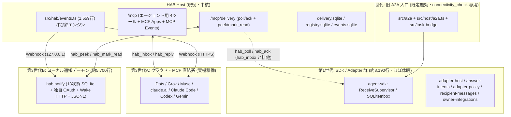
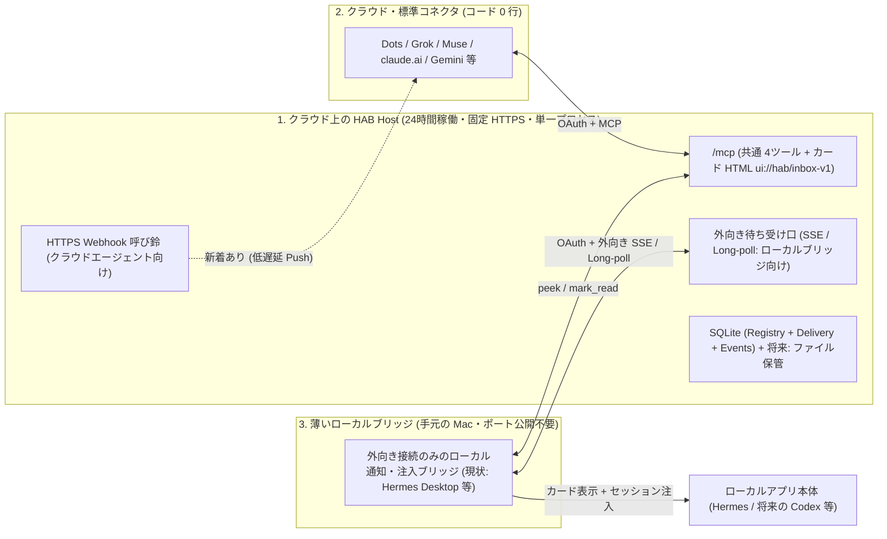

# 設計レビューと簡素化計画（受信処理・コネクタ中心）

作成日：2026-11-28 JST · 対象コミット：`93aacff` · 状態：**レビュー記録・計画案（未着工）**

関連：[HAB の構成](../architecture.md) · [設計判断（ADR）](../hab-decisions.md) · [エージェント設定手順](../connections/agent-setup.md) · [受信通知アダプタ](../receiver/arrival-notifier.md) · [MCP イベント](../connections/mcp-events.md) · [接続と導入を簡単にする](agent-connection-and-receive.md)

---

## 1. 背景と本当にやりたいこと

HAB の目的を改めて整理すると、次の 5 点＋運用前提（クラウド移行）に集約される。

1. **低遅延でエージェント間メッセージを送信したい。**
2. **エージェントがローカル・クラウドのどちらにあっても問題なく送受信できるようにしたい。**
3. **対応エージェントを新たに追加・削除しやすいよう、コネクタ部分をできるだけシンプルにしたい。**
4. **受信したエージェントには、できるだけ「何をするべきか」をカード形式で表示したい。**
5. **後々はファイルのやり取りもできるようにしたい。**
6. **HAB Host 自体は現在の Mac 運用からクラウドへ移行したい。**

本ドキュメントは、これらに照らして現行の HAB 設計（特に各エージェントとの接続・受信処理）をレビューし、複雑化の原因と段階的な簡素化・クラウド移行プランをまとめたものである。

---

## 2. 全体設計の診断

### 2.1 コア設計は堅実

中央の Host（`src/host`・`src/hab`・`src/delivery`・`src/messaging`）は筋の良い構成になっている。

- **単一 Host + SQLite 単独構成**（ADR-018）：NATS JetStream を撤去し、`delivery.sqlite` 1 ファイル（約 1,169 行）へ集約した判断は妥当。
- **メール型 API への整理**（ADR-015 / ADR-020）：HAB は名義・宛先・保管・配送に責務を限定し、エージェントには封筒詳細を隠した 4 ツール（`hab_send` / `hab_inbox` / `hab_reply` / `hab_status` + `hab_discover`）だけを見せる形は実運用に適合している。
- **運用・認証境界**：認証グループ（ADR-014）、未登録サインインの承認待ち→ `approve`、`doorbell add/remove`、`doctor` により、ローカル（loopback）とクラウド（OAuth 公開 HTTPS）の両口を安全に扱えている。

### 2.2 複雑さの正体：「3 世代の受信アーキテクチャ」が同居している

コード規模と import 関係を調査したところ、総コード量（`src/` + `scripts/`）の大きな割合を、歴史的に積み重なった **3 世代の受信モデル** が占めている。

| 層（世代）                                    | 主なモジュール                                                                                                                                                                                                                |     行数（目安） | 現在の実態                                                 |
| --------------------------------------------- | ----------------------------------------------------------------------------------------------------------------------------------------------------------------------------------------------------------------------------- | ---------------: | ---------------------------------------------------------- |
| **コア（Host / 配送 / 認証 / 管理）**         | `src/host`, `src/hab`, `src/delivery`, `src/messaging`, `src/admin`                                                                                                                                                           |     約 15,200 行 | **現役・中核**（うち `src/hab/events.ts` 単体で 1,559 行） |
| **第 1 世代：SDK 永続受信 + 任意 Adapter 群** | `src/agent-sdk` (3,726), `src/adapter-host` (1,171), `src/answer-intents` (869), `src/recipient-messages` (710), `src/owner-integrations` (666), `src/adapter-policy` (588), `src/reply-watch` (319), `src/task-bridge` (138) |  **約 8,190 行** | **ほぼ休眠・孤立**（実エージェント接続では未使用が大半）   |
| **第 2 世代：旧 A2A 入口**                    | `src/a2a` (1,414), `src/host/a2a.ts` (708)                                                                                                                                                                                    |      約 2,120 行 | 既定無効。`connectivity_check` 専用 Task gateway           |
| **第 3 世代：現行の受信通知・呼び鈴系**       | `src/agent-notify` (4,325), `scripts/hab-notify.ts` (1,014), `scripts/lib/notify-product.ts` (401), `src/hab/events.ts` (1,559), `src/hab/inbox-wait.ts`, `src/hab/inbox-app.ts`                                              | **約 7,300 行+** | **実機運用の主戦場**                                       |

さらに、`README.md` や `docs/architecture.md` では第 1 世代の `ReceiveSupervisor`（保存後 ACK）が「標準接続の基準」と記述されたままになっている一方、ADR-021 は「`agent-sdk` の保存後 ACK と `hab:notify` / `hab_inbox` は併用不可（先に ACK すると読めなくなる）」と明記しており、**文書上の標準と実運用の標準が衝突している**。

---

## 3. 各エージェントの接続・受信方式の実態

`docs/connections/agent-setup.md`、`docs/receiver/arrival-notifier.md`、`src/agent-notify/*` の実装を突き合わせた現行の接続実態は次のとおり。

| 製品                     | MCP 接続                                     | 起こし方（受信トリガー）                                                                     | 見せ方                                                                                 | 引渡し・返信                                                                                                                            | 自動受付（許可制御）                                                     | 実機・コード実態                                                                                                                 |
| ------------------------ | -------------------------------------------- | -------------------------------------------------------------------------------------------- | -------------------------------------------------------------------------------------- | --------------------------------------------------------------------------------------------------------------------------------------- | ------------------------------------------------------------------------ | -------------------------------------------------------------------------------------------------------------------------------- |
| **Hermes Desktop**       | `/mcp`（会話）＋ `/mcp/delivery`（notifier） | **Loopback Hook**（運用者呼び鈴 → `hab:notify` の `wake-listener`）＋保険の定期 poll（5 分） | JSONL 書込み → ローカル fork プラグインが `hab-notify events` を定期実行してカード描画 | ボタン押下 → `hab-notify action` → `hab_mark_read` → Python `desktop_handoff`（`session.resume` + `prompt.submit`）→ 会話が `hab_reply` | **`notify.json` の `auto_accept`**（コード強制・件数上限・監査ログあり） | **実機確認済み**（ローカル fork プラグイン前提。`session_probe` は実機未確認）                                                   |
| **Dots (ChatGPT)**       | `/mcp`（Auth0 OAuth）                        | **MCP Events 購読**（OpenAI へ HTTPS Webhook 呼び鈴）→ 見張りタスク起動 → `hab_inbox`        | 会話内テキスト（MCP Apps カードは取りに来ない）                                        | 見張りタスクのモデルが `hab_reply`                                                                                                      | **見張りタスクのプロンプト文面**（LLM 依存）                             | **実機確認済み**（1 アカウント 1 購読・購読切れ制約あり）。`src/agent-notify/chatgpt-connector.ts` は常に `unsupported` で未使用 |
| **Grok Bot**             | `/mcp`（Auth0 OAuth）                        | **運用者登録呼び鈴**（xAI Routine Webhook へ HTTPS POST）→ Routine 起動 → `hab_inbox`        | Bot チャットにテキスト                                                                 | Routine のモデルが `hab_reply`                                                                                                          | **Routine のプロンプト文面**（重複排除なし）                             | **実機確認済み**                                                                                                                 |
| **Muse**                 | `/mcp`（Auth0 OAuth）                        | **製品側ポーリング**（15 分予定タスク → `hab_inbox`）。HAB は `poll_overdue` を監視          | 会話内テキスト（カード非対応）                                                         | 予定タスクのモデルが `hab_reply`                                                                                                        | **予定タスクのプロンプト文面**                                           | **実機確認済み**                                                                                                                 |
| **claude.ai**            | `/mcp`（Auth0 OAuth）                        | **手動**（話しかけた時だけ `hab_inbox`、任意で `wait_secs` long-poll）                       | **MCP Apps カード**（`ui://hab/inbox-v1`）                                             | カード押下 → `ui/message` で会話に依頼文を挿入 → モデルが返信案提示                                                                     | なし（手動）                                                             | **実機確認済み**（カード表示含む）                                                                                               |
| **Claude Code**          | `/mcp`（public OAuth）                       | **製品側ポーリング**（`/loop 10m` / 予定タスク）or `wait_secs`                               | 会話内テキスト（別途 `statusline` 実装あり）                                           | 会話内で `hab_reply`（同梱 `claude-channel` は会話検証不可のため常に `unsupported`）                                                    | `/loop` 文面 or 手動                                                     | MCP + `/loop` が現実解。`hab:notify` 側は実機未確認                                                                              |
| **Codex**                | `/mcp`（OAuth）                              | **手動**（外から会話に入る口がない）                                                         | 会話内テキスト                                                                         | 会話内で `hab_reply`（`codex.ts` の app-server WS はデスクトップ版で動作せず、`codex queue` を別計画で検討中）                          | 手動                                                                     | `codex.ts` の WS 経路は実機不可                                                                                                  |
| **Gemini / Antigravity** | `/mcp`（OAuth・未検証）                      | **手動**（外部通知の公開口なし）                                                             | ツール結果テキスト（Gemini は MCP Apps 候補・未確認）                                  | 会話内                                                                                                                                  | 手動                                                                     | 計画段階（未実装・未検証）                                                                                                       |

---

## 4. 「汎用的に作ったのに複雑になった」5 つの根本原因

1. **受信パラダイムが 3 系統に分かれ、旧世代が残存している**
   - ① 分散キュー型（`hab_poll` / `hab_ack` + `agent-sdk` の `SQLiteInbox`）
   - ② メールボックス型（`hab_inbox` + 7 日既読保持 + `wait_secs`）
   - ③ 覗き見＋ローカル状態機械型（`hab_peek` / `hab_mark_read` + `hab:notify`）
   - 稼働しているのは ② と ③ だけだが、① のコード（約 8,000 行）とドキュメントが残存している。

2. **`AgentScreen` / `hab:notify` という単一の汎用抽象に無理がある**
   - クラウド系はローカル常駐プロセスから画面描画もセッション注入もできず、結局 Webhook（`events.ts`）と MCP Apps（`inbox-app.ts`）で別対応した。
   - ローカル系でも、Hermes 以外の 3 アダプタ（`chatgpt-connector.ts` / `claude-channel.ts` / WS 版 `codex.ts`）は製品側の公式口不足により常に `unsupported` または実機動作不可となっている。
   - 結果として **約 5,700 行の汎用フレームワークが事実上「Hermes Desktop 専用ミドルウェア」** になっている。

3. **`src/hab/events.ts`（1,559 行）への責務集中と通知機構の分散**
   - 1 ファイルの中に SSRF 防御付き HTTPS/Loopback 送信、Standard Webhooks 署名、MCP Events 購読、`config.json` と `events.sqlite` の二重呼び鈴管理、スリープ寿命延長（ADR-024）、鳴らし直し（ADR-027）、静かな時間（ADR-030）、不在判定 `410 session_gone`（ADR-032）、`inbox_reminder` 集計、廃止済み `inbox_check` の互換処理が密集している。
   - 受信を知らせる/待つ機構も「MCP Events / 運用者 Webhook / Loopback Wake / `hab_inbox(wait_secs)` / `reply-watch`」の 5 系統に分散している。

4. **状態の「正（Source of Truth）」が多重化している（特に Hermes 経路）**
   - 1 通のメッセージが `delivery.sqlite` → `events.sqlite` → `registry.sqlite` → `notices.sqlite`（13 状態）→ `hermes-desktop.jsonl` → Hermes `state.db` / `localStorage` と最大 6 箇所を通過する。
   - さらに `hab:notify` が refresh token 競合回避のため独自の OAuth ログイン・`TokenPool`・ファイルロックを抱えている。

5. **厳密なステートマシンとプロンプト委任の非対称性＋CLI の肥大化**
   - `hab:notify` は 13 状態（`showing` / `shown` / `later` / `declining` / `declined` / `accepting` / `accept_waiting` / `started` / `queued` / `unsupported` / `unknown` / `unavailable` / `expired`）を厳格管理する一方、クラウド勢はプロンプト文面だけで実用上回っている。
   - `scripts/hab-notify.ts` が 1,014 行に肥大化し、常駐デーモン・人間用 CLI・Hermes 専用 IPC（`events` / `action`）・Claude Code `statusline`・OAuth ログインが 1 ファイルに混在している。

---

## 5. 引き算した目標アーキテクチャ（クラウド移行前提の 3 パーツ構成）

1 章の要件と **HAB Host のクラウド移行** を前提に置くと、最もシンプルな形は次の **3 パーツ** になる。

### 5.1 設計原則（コネクタをシンプルに保つ 3 つの割り切り）

1. **エージェント側の標準コネクタは「MCP 設定 1 つ（コード 0 行）」にする**
   - 追加・削除は「製品に MCP URL を登録」＋「HAB で `approve` / `revoke`（必要なら `doorbell add/remove`）」だけで完結させる。
   - **カード表示は Host が配る MCP Apps（`ui://hab/inbox-v1`）と `presentation` を基本**にし、非対応製品では `notice` テキストで「誰から・何をするべきか・期限・選択肢」を見せる。
2. **低遅延の起こし方は「クラウドは HTTPS Webhook、ローカルは外向き待ち受け」に割り切る**
   - **クラウドエージェント**（Dots = MCP Events / Grok = 運用者 Webhook）：クラウド HAB から HTTPS Webhook（Push）で起こす。外部 Push を受けられない製品（Muse / claude.ai / Gemini 等）は製品側スケジュールまたは `hab_inbox(wait_secs)` で受ける。
   - **ローカルエージェント**（Mac 上の Hermes / 将来の Codex 等）：ローカルからクラウド HAB へ**外向き常時待ち受け（SSE または Long-poll）**を張る。クラウドから自宅 Mac へ Webhook を届けるためのポート公開・Tailscale Funnel・`wake-listener.ts`・`127.0.0.1` 呼び鈴特例・`wake.secret` 鍵ファイル管理がすべて不要になる。
3. **ローカルブリッジ（`hab:notify`）は「本当に動くローカル製品」だけに絞って薄くする**
   - 未稼働・常に `unsupported` になる画面アダプタは本体から外し、新しいローカル製品を足すときの負担を下げる。

### 5.2 将来のファイルやり取りを見据えた方針

- 現行の **メール型 `/mcp`（クラウド Host 中央保管）** へ一本化しておけば、将来ファイル交換を追加する際に以下の構成が自然に載る。
  - クラウド Host にファイル保管領域（または S3 / R2 等のオブジェクトストレージ＋短命署名付き URL）とアップロード／ダウンロード手段を追加する。
  - メッセージ本文にはファイルの実体ではなく **参照メタデータ（`file_id`, ファイル名, MIME, サイズ, 期限）** だけを載せる。
  - 自宅回線の帯域や Mac のスリープを気にせず、クラウド・ローカルを問わず全エージェントが同じ仕組みでファイルを受け取れる（クライアント側 `SQLiteInbox` や JSONL に実体を複製する第 1 世代構造では破綻しやすいため、第 1 世代を削る方向とも一致する）。

### 5.3 クラウド移行の方針と設計への影響

HAB Host を Mac mini からクラウドへ移行すると、受信設計・運用の両面で次の変化が生じる。

#### クラウド移行で解消する複雑さ（メリット）

- **ローカル Webhook 受信サーバーの廃止**：Mac 上の `wake-listener.ts`、Host の `127.0.0.1` 呼び鈴特例、Mac 側 `wake.secret` 鍵管理が不要になり、既存の `src/hab/inbox-wait.ts`（`InboxArrivals`）と同系統の軽量な外向き待ち受け口へ一本化できる。Mac のスリープ復帰時も自動再接続で取りこぼしを防げる。
- **Mac スリープによる購読切れの解消**：ADR-024 で対処していた「Mac スリープ中に Dots の MCP Events 購読が切れる問題」や `caffeinate` の LaunchAgent 管理から解放される。
- **クラウドエージェント間の低遅延・安定化**：Tailscale Funnel 経由の自宅 Mac 折り返しがなくなり、Dots ⇄ Grok ⇄ claude.ai 等の通信がクラウド内で完結する。

#### クラウド移行時に決めるべき 3 点

1. **実行環境（インフラ形態）**：**永続ディスク付き 1 台 VM / コンテナ**（VPS、GCE、Lightsail、Fly.io Volume 等）を第一候補とする。ADR-018 は「1 台の VM ＋ SQLite 単一ファイル」前提で設計されているため、現行コードの大部分をそのまま移行できる（Cloud Run / Workers 等のステートレス環境だと SQLite と `0600` ローカルファイル構造の書き直しが必要になる）。
2. **管理操作（`approve` / `doctor` / `doorbell`）の入口**：現在は Mac 上で直接 SQLite と OAuth 台帳を開く `hab:admin` CLI 前提。クラウド化後は、① VM へ SSH / Tailscale 経由で `hab:admin` を実行するか、② Tailscale 限定（または Auth0 認証付き）の Web ダッシュボード（`src/admin/`）から操作する形へ寄せる。
3. **状態ファイル・秘密の保管とバックアップ**：`registry.sqlite` / `delivery.sqlite` / `events.sqlite` / OAuth 接続台帳 / doorbell 鍵ファイルを VM の永続ボリューム上の専用ディレクトリ（`0700`）へ集約し、定期バックアップ手順を整備する。

---

## 6. 第 1 世代および旧 A2A の詳細棚卸し

コードベース全体（`src/`・`scripts/`・`test/`・`verification/`・`.github/workflows/`）を調査した結果の正確な仕分け。

### 6.1 層 A：本番経路から完全孤立（19 ファイル・4,004 行）

Host 本番・`hab:admin`・`hab:notify`・A2A のどこからも参照されていない。

| モジュール                          |  行数 | 実際の参照元（テスト除く）                     | 切り離しメモ                                           |
| ----------------------------------- | ----: | ---------------------------------------------- | ------------------------------------------------------ |
| `src/owner-integrations/` (3 files) |   666 | **0 件**                                       | 完全孤立                                               |
| `src/recipient-messages/` (3 files) |   710 | `owner-integrations` のみ                      | 同時に完全孤立                                         |
| `src/adapter-host/` (8 files)       | 1,171 | 上 2 つ + `scripts/lib/local-mvp.mjs`          | デモ専用化                                             |
| `src/answer-intents/` (2 files)     |   869 | `adapter-host` + `scripts/lib/local-mvp.mjs`   | デモ専用化                                             |
| `src/adapter-policy/` (3 files)     |   588 | 上記 + `scripts/lib/native-trial-preflight.ts` | `sourceKey`（zod 定義 1 個）を数行インライン化で分離可 |

### 6.2 層 B：`src/agent-sdk/` の内部切り分け（12 ファイル・3,726 行）

| 区分             | ファイル                                                                                                                   |      行数 | 参照元                                                                                    | 扱い                                                                    |
| ---------------- | -------------------------------------------------------------------------------------------------------------------------- | --------: | ----------------------------------------------------------------------------------------- | ----------------------------------------------------------------------- |
| **現役（必須）** | `sqlite-host-owner.ts`                                                                                                     |       251 | `src/host/server.ts`（二重起動ロック）                                                    | **残す**（将来 `src/host/` へ移動候補）                                 |
| **現役（必須）** | `mcp-client.ts`                                                                                                            |       583 | `src/hab/mcp-client.ts` → `src/agent-notify/`                                             | **残す**（将来 `src/hab/` へ移動候補）                                  |
| **A2A 専用**     | `receiver.ts`, `sender.ts`, `sqlite-inbox.ts`, `sqlite-outbox.ts`                                                          |     1,641 | `src/host/a2a.ts` のみ                                                                    | **A2A の去就次第**（＋`src/task-bridge/contract.ts` 138 行も A2A 専用） |
| **完全未使用**   | `receive-host.ts`, `receive-supervisor.ts`, `sqlite-host-control.ts`, `authentication-recovery.ts`, `guard.ts`, `index.ts` | **1,251** | 層 A・デモ・テストのみ（`authentication-recovery.ts` のみ `reply-watch` から 1 関数参照） | **削除候補**                                                            |

### 6.3 層 C：周辺オプションと旧 A2A の位置づけ

- **旧 A2A 入口（`src/a2a/` 1,414 行 ＋ `src/host/a2a.ts` 708 行 ＋ `src/task-bridge/contract.ts` 138 行 ＋ 上記 A2A 専用 4 ファイル 1,641 行 ＝ 計 約 3,900 行）**
  - 現在の実装は汎用メッセージング用ではなく、旧 Task Hub 由来の `task_type: "connectivity_check"` 専用（`execution_request` → `execution_accepted` / `execution_result`）かつ既定無効である。
  - 1 章の 5 要件だけを見るなら、**今の古い実装は一度降ろして身軽にし、将来 A2A が本当に必要になったときに現行メール型の上へ薄く作り直す**のが合理的（残す場合でも Phase 1 の削減は独立して実施可能）。
- **`scripts/lib/local-mvp.mjs`（667 行、`npm run demo:hab-mvp`）**
  - 第 1 世代（`AdapterHostCycle` 等）を組み立てるデモ。現行メール型 `/mcp` ベースへ簡素化するか、`verify-hab` へ統合して廃止する。
- **`src/reply-watch/`（319 行）＋ `scripts/hab-reply-watch.ts`（145 行）**
  - `hab_status` を定期監視する独立 CLI。呼び鈴＋`hab_inbox(wait_secs)` で足りるなら廃止対象（`src/hab/reply-watch.ts` 30 行とは分離済み）。

### 6.4 削除時に必ず同時更新が必要な CI 設計検証ゲート

`.github/workflows/design-verification.yml` が第 1 世代を直接参照しているため、コード削除とセットで以下を更新する必要がある（ADR-018 の JetStream 撤去時と同じ手順）。

1. **`verification/design/contract.json`**（159 文書・23 チェック・79 要件）
   - 層 A 専用の 8 コマンドチェック（`js-recipient-messages`, `js-recipient-host-mcp`, `js-single-source-stdio`, `js-private-recipient-http`, `js-external-owner`, `js-acp-owner`, `js-managed-transport`, `js-source-launch`）を削除し、該当要件を `decision: "historical"` へ移行。
   - `js-common-mcp`（`package.json` の `test:communication-boundary`）のテスト一覧を更新。
   - 削除・変更した文書の `sha256` と `source-review.json` を整合させる。
2. **`verification/design/checks/communication-boundary.mjs`**
   - `coreModules` / `outerModules` に固定列挙されている `src/agent-sdk/*` の一覧を更新。
3. **`verification/design/checks/mcp-durable-roundtrip.mjs` ＋ `assert-automated.mjs`**
   - `SQLiteInbox` + `DurableReceiver` を必須チェックとしている。Phase 2 でこれらを削除する場合は、現行メール型 `/mcp` 往復の検証へ置き換える。
4. **`.github/workflows/design-verification.yml`**
   - `verification/experiments/cross-process-handoff`（`src/recipient-messages` の Python 実験モデル）の実行ステップを整理。

---

## 7. 段階的リファクタリング・クラウド移行計画（Phase 1〜5）

一度に大きく壊さず、PR を分けて進める。

| Phase                                                          | 作業内容                                                                                                                                                                                                                                                                                                                                                                                                                                                                                                                                                                                                                         | 主な効果・削減見込み                                                                            |
| -------------------------------------------------------------- | -------------------------------------------------------------------------------------------------------------------------------------------------------------------------------------------------------------------------------------------------------------------------------------------------------------------------------------------------------------------------------------------------------------------------------------------------------------------------------------------------------------------------------------------------------------------------------------------------------------------------------- | ----------------------------------------------------------------------------------------------- |
| **Phase 1：第 1 世代の廃止**                                   | ・ADR-033（案）を追加し、標準受信をメール型 `/mcp`＋3 モード＋任意ローカル通知へ一本化 ・層 A（5 モジュール 19 ファイル）＋ `agent-sdk` 未使用 6 ファイル ＋ `reply-watch` CLI ＋ 対応テスト・旧文書を削除 ・`native-trial-preflight.ts` の `sourceKey` をインライン化、`local-mvp.mjs` を整理 ・`verification/design/`・`communication-boundary.mjs`・`README.md`・`docs/architecture.md` を整合                                                                                                                                                                                                                       | **約 5,700 行削除**。ドキュメントと実運用の矛盾が解消                                           |
| **Phase 2：旧 A2A の撤去（または隔離）**                       | ・旧 `connectivity_check` 専用 A2A（`src/a2a` / `src/host/a2a.ts` / `src/task-bridge` / `agent-sdk` 残 4 ファイル）を撤去 ・現役の `sqlite-host-owner.ts` → `src/host/`、`mcp-client.ts` → `src/hab/` へ移動し、`src/agent-sdk` 層を解消 ・`mcp-durable-roundtrip.mjs` をメール型 `/mcp` 往復チェックへ更新                                                                                                                                                                                                                                                                                                                | **さらに約 3,900 行削除**（Phase 1〜2 合計で `src/` の約 1/3 を削減）                           |
| **Phase 3：`src/hab/events.ts` の分割・簡素化**                | ・1,559 行の単一ファイルを「Webhook 送信・署名・SSRF 防御」「購読・呼び鈴・不在の SQLite ストア」「配信スケジューラ」「診断・リマインダ投影」の 4 モジュールへ分割 ・`config.json` の静的 `doorbells` と `events.sqlite` 台帳の二重管理、および退役済み `inbox_check` 互換コードを整理 ・`quiet` と `rering` の状態ルールを単純化（`wake-model.md` §5 の考え方を再評価）                                                                                                                                                                                                                                                   | 呼び鈴エンジンの保守性・テスト容易性が大幅向上                                                  |
| **Phase 4：`hab:notify` のスリム化とローカル外向き待ち受け化** | ・実機で動かない 3 画面アダプタ（`chatgpt-connector.ts` / `claude-channel.ts` + `scripts/hab-claude-channel.ts` / WS 版 `codex.ts`）を本体から外す（必要なら `experiments/` へ退避） ・`scripts/hab-notify.ts`（1,014 行）を「デーモン部」「Hermes プラグイン IPC 部」「設定・OAuth ヘルパ」に分割 ・クラウド移行に備え、ローカル起動方式を「`127.0.0.1` 呼び鈴受け口（`wake-listener.ts`）」から「Host への外向き SSE / Long-poll（`InboxArrivals` 活用）」へ置換し、`127.0.0.1` 呼び鈴特例と `wake.secret` を廃止 ・13 状態ステートマシンと `notices.sqlite`＋`JSONL` 二重永続化の簡素化（ローカル API 化も含め検討） | ローカルブリッジが薄くなり、Mac 側のポート公開なしでクラウド HAB から低遅延受信できる構造になる |
| **Phase 5：HAB Host のクラウド移行**                           | ・永続ディスク付き 1 台 VM / コンテナへ HAB Host（＋TLS リバースプロキシ）を配備 ・SQLite・OAuth 台帳・doorbell 鍵の移行と自動バックアップ設定 ・管理操作の経路（SSH/Tailscale CLI または認証付きダッシュボード）と Auth0 callback / 公開 URL の切替 ・クラウドエージェント（Dots / Grok / Muse / claude.ai）＋ Mac ローカルブリッジ（Hermes 等）の疎通確認                                                                                                                                                                                                                                                             | 24 時間稼働・Mac スリープ問題解消・クラウド間低遅延化・将来のファイルやり取り基盤が完成         |

---

## 8. 着工前に確定すること

1. **Phase 2（旧 `connectivity_check` 専用 A2A）の扱い**：今回まとめて撤去するか、残して `src/a2a/` 配下へ隔離するか。
2. **`demo:hab-mvp`（`scripts/lib/local-mvp.mjs`）の扱い**：現行メール型 `/mcp` のデモへ書き換えて残すか、`verify-hab` へ統合して廃止するか。
3. **`hab:reply-watch`（`src/reply-watch`）の扱い**：廃止するか残すか。
4. **Phase 4 のローカル待ち受け方式と Hermes 連携**：
   - クラウド HAB への外向き待ち受けを **SSE** にするか **Long-poll（`hab_peek(wait_secs)` 拡張）** にするか。
   - Hermes プラグイン連携は現状の JSONL + CLI サブプロセスを維持して内部だけ整理するか、ローカル HTTP API へ寄せて JSONL を無くすか。
5. **Phase 5 のクラウド環境と管理入口**：
   - 利用するクラウド先（VPS / GCE / Fly.io 等、永続ボリューム付き 1 台構成）。
   - 管理操作は SSH/Tailscale 経由の `hab:admin` CLI にするか、Web ダッシュボードを主にするか。
