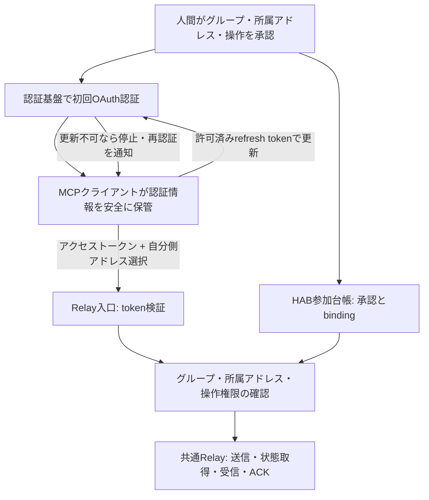

# Relayの認証グループとBotアドレス

[正式仕様 §4.3](hab-relay-spec.md#43-検証済み接続認証グループとアドレス選択) · [設計判断 ADR-014](hab-decisions.md) · [共通MCP接続](common-mcp-connection.md)

2026-10-25 JSTに採用した設計判断。**認証は参加グループ単位、Botの切り分けはアドレス単位**とする。グループは本人が承認する接続の信頼範囲であり、製品全体や全利用者を表さない。製品名による認証・配送分岐は設けない。

**Registryの認証グループ・所属・認可を実装済み、MCPへの配線は未完了。** 従来の1対1 bindingは維持し、明示的な`authentication_groups: true`と`migrate()`で追加schemaを有効にする。通常のサービス設定はまだこの選択を受け付けず、OAuth入口は最大15分の試験用許可窓のままである。実接続・常用token更新・稼働設定変更は行っていない。

## 認証とアドレスの役割

| 概念                   | 役割                                                                                                            |
| ---------------------- | --------------------------------------------------------------------------------------------------------------- |
| 認証グループ           | 検証済み認証主体に紐付く、本人が承認した信頼範囲。opaqueな不変IDで識別する                                      |
| グループのアドレス集合 | 管理操作で登録した、そのグループが利用できるBot個体の集合。1件でも複数件でもよい                                |
| Bot個体                | 不変の`agent_id`と`<bot_name>@<agent_name>.hab`を持つ配送名義・受信箱。グループ内の独立した認証主体とは限らない |
| アクセストークン       | Relay向けの有効な認証と操作権限を検証する材料。Bot名やアドレスを知っているだけでは代用できない                  |
| 参加承認               | グループの有効状態、所属アドレス、操作権限を管理する記録。トークンの有効期限と別に扱う                          |

例えば一つの承認済み接続が、ダミーの`research@grok-bot.hab`と`calendar@grok-bot.hab`を共有できる。別の接続が`lab@hermes.hab`だけを使う場合も同じ契約とする。`agent_name`を見て認証方式やグループを推測しない。各アドレスは同時に一つのグループだけへ所属させる。別グループへの移管は本判断に含めず、暗黙に行わない。

## 操作ごとの認可

1. Relay入口が認証を検証し、server管理のbindingからグループを特定する。OAuthでは署名、issuer、audience、期限、必要scopeを確認する。公開client IDや自己申告のgroup IDだけで認証しない。
2. 呼出元は送信名義または操作対象の自分側アドレスを選ぶ。serverは登録済み集合への所属、有効状態、必要な操作権限を確認し、確定した`agent_id`をRelay coreへ渡す。
3. 未登録・別グループ・停止済みの自分側アドレスは拒否する。複数候補があるときの省略・曖昧な指定も拒否し、別名義へ自動で切り替えない。1件だけの従来接続は暗黙の選択を維持できる。
4. `submit`の宛先は相手のアドレスであり、自分側の所属検査とは別に、既存のメール型相互通信policyで検証する。別グループへの通常の送信は可能だが、相手の名義で送信したり相手の受信箱を操作したりはできない。
5. `status`は選択した送信名義のmessage、`poll`と`ack`は選択した受信名義の配送だけを扱う。返信参照、lease／世代、receipt、block、停止、epochの検証は維持する。message ID・thread ID・lease tokenだけで権限を得ない。

アドレスの選択は**認証済みグループ内での名義選択**であり、認証・権限付与ではない。確定済みmessageの`sender_id`は引き続きserverが付与する。送信outboxには選択した自分側個体と元の宛先・messageを固定し、再送で別名義へ変更しない。受信storeとACK状態も選択した個体ごとに分離し、他の受信箱へACKを付け替えない。

現在の厳格なMCP schemaへ未定義のsender／group引数を追加しても、この設計は有効にならない。アドレス選択の具体的なwire形式は、既存1対1接続との互換性・version・全5操作の認可を揃えて別途実装する。製品ごとのtoolや配送APIは作らない。

## 許容する共有範囲と停止

同じグループの資格情報を共有するBotは、そのグループに属する有効アドレスを使える。別Bot名義の使用や受信箱の閲覧をグループ内で厳密に隔離しない。あるBotへのプロンプトで「他のアドレスを使わない」と指示しても、認証上の隔離とは呼ばない。共有資格情報の漏洩時はグループ全体へ影響する。

一方、グループ外の名義使用・受信箱の閲覧、通常の配送権限によるグループ登録・所属変更・権限追加は禁止する。本人の管理操作でのみグループと所属アドレスを有効化する。グループ間は認可境界として維持する。

- グループ停止・認証bindingの失効は、所属する全アドレスの操作を止める。
- アドレス単位の停止・廃止・操作権限は維持する。別Botから同じ停止アドレスを指定しても利用できない。他の有効アドレスには自動で影響させない。
- 各操作で現在のグループ状態・所属・アドレス状態・権限を再確認する。変更と配送commitの競合を防ぎ、古いcontextで操作を続けない。通常の停止後ACK拒否policyも維持する。

監査には認証済みグループIDと選択した個体ID、操作、結果、時刻を区別して残す。共有認証では「research名義で送信された」と記録できるが、researchというBotだけが実行したという証明にはしない。本文やtokenは監査記録へ入れない。

## OAuth接続と更新の責務

人間の参加承認とアクセストークンの期限は別に管理する。認証基盤が更新を許し、MCPクライアントが対応している場合、クライアントが短期tokenを更新する。モデルへtokenの保管・更新を依頼しない。更新後も同じ承認済みグループへ対応させ、scopeの拡大や新規アドレスの追加を自動で許可しない。更新失敗・失効・期限切れ時は停止し、必要な再認証を通知する。初回承認だけで永久に無人接続できるとは保証しない。

HAB参加台帳には承認、状態、権限、所属と認証bindingを保存し、アクセストークン／リフレッシュトークン本体は置かない。秘密は承認済みのクライアント保管先が管理する。client登録方式は事前登録・CIMD・DCRなど、hostと認証基盤が対応する標準方式を使い、特定製品の設定形式をRelay coreへ持ち込まない。全方式の実装・現Auth0との互換性を確認済みとは扱わない。

現行の15分・refreshなしの試験設定はそのままでは常用設計を満たさない。長期の参加承認と短期tokenの分離、更新許可・保管・失効は後続の実装と具体的な接続承認の対象とする。

## 共通の受入れ条件と残作業

- 同じコードと設定モデルで「1グループ1アドレス」「1グループ複数アドレス」を扱う。共有認証環境でBotごとの秘密分離は要求しない。
- 同一グループ内の2アドレスが名義を選んで送受信・保存後ACKでき、別グループの自分側アドレス選択は全操作で拒否される。
- 他グループへの正規の送信・返信は成功する。存在しないアドレス・曖昧な選択・無権限操作は拒否する。
- 更新後・再起動後も同じグループと所属へ対応し、固定outbox／inbox・dedup・ACK状態を別名義へ付け替えない。
- グループ失効とアドレス単位の停止を個別に検証し、処理中の変更も認可とcommitの間で取りこぼさない。
- 監査でグループと名義を区別し、Bot本人性を過大に表示しない。MCP登録だけで受信起動・永続保存・自動返信を保証しない。

Registryの管理portは`createGroup / bindGroupVerified / addGroupMember / setGroupAccess / revokeGroupBinding`。いずれも別管理権限・要求idempotency・epochを検証し、配送MCPからは公開しない。`selectAddress`は不透明な選択contextを作るだけで、`withRelay`が認証・所属を共有write guard内で検証する。`groupAuthorizations`は管理者用のbounded読取りで、認証グループと選択名義を分けた認可記録を返す。配送receiptやBot本人性の証明ではない。認可記録は`max_audit_records`で上限を設け、保存不可なら配送を開始しない。監査記録の回収・運用手順は後続で整備する。

追加schema自身は`hab_auth_group_meta` version 1で管理し、明示opt-in migrationでRegistry本体をversion 1から2へ上げる。旧runtimeがグループ制約を無視してDBを開くことを防ぐ。version 2から1への書換えによるrollbackは禁止し、移行前backupを停止状態で復元する。グループ数と所属数は`max_agents`、legacyとgroupの合計binding数は`max_bindings`で制限する。既存credentialを暗黙にグループへ付け替えず、予約済みfingerprintを別主体へ再利用しない。機能を無効にして再起動しても所属と予約は残り、グループ個体への操作は拒否する。既存DBのbackup／restoreへ追加tableを含める検証は別途必要。

`node --test test/hab-auth-groups.test.js test/hab-registry.test.js test/hab-authorization.test.js`で、一時DB・合成主体による共有名義、外部拒否、停止・失効、再起動、idempotency、監査失敗と1対1回帰を確認する。実OAuth更新の試験ではない。

残作業はversionedなMCPアドレス選択、クライアントの固定名義、サービス設定への明示配線、グループschemaのbackup／restoreと監査保守、実製品での受入れ、常用token更新。既存サービス・本番DB・認証grant・公開経路は変更していない。
